# Laporan Modul 2: Rendering Pipeline & Primitif 2D
**Mata Kuliah:** Praktikum Grafika Komputer (Program Sarjana S1 Informatika)  
**Institusi:** Fakultas Teknik, Universitas Muhammadiyah Surabaya  
**Sub-CPMK-2:** Mampu menjelaskan pipeline rendering & menampilkan primitif 2D/3D dengan pustaka grafika (Modul 1–2)  
**Penyusun:** Praktikan Grafika Komputer  
**Tanggal Pengujian Aktual:** 21 Oktober 2026  

---

## Informasi Praktikum dan Lingkungan

Pengujian kode, komparasi raster, verifikasi numerik, dan pengukuran performa dalam laporan ini dilaksanakan secara langsung pada lingkungan komputasi nyata berikut:
- **Sistem Operasi:** Windows 11 Home Single Language (64-bit, Build 26100, NT kernel 10.0)
- **Runtime JavaScript:** Node.js `v22.14.0` (V8 Engine v12.9)
- **Package Manager:** npm `11.3.0`
- **Pustaka Grafika Web:** Three.js `r170` (v0.170.0)
- **Lingkungan Browser & WebGL:** Microsoft Edge 133.0 (Chromium/Blink engine, Direct3D 11/ANGLE backend)
- **Perangkat Keras:** x86_64 CPU multi-core, GPU terintegrasi/diskret berarsitektur hardware rasteriser modern
- **Konvensi Modul:** Pure JavaScript (ES Modules, `"type": "module"`) tanpa framework backend; implementasi *from-scratch* mandiri untuk algoritma garis, segitiga, dan manipulasi *framebuffer*.

---

## 1. Tugas Studi Pendahuluan

### Q1. Pipeline dan Light Transport

#### Q1(a) Rendering Pipeline Tujuh Tahap
Sesuai dengan §1.2 pada Modul 2 Praktikum Grafika Komputer, *rendering pipeline* adalah rangkaian tahapan berurutan dan terstruktur yang mengubah representasi data geometris matematis menjadi citra raster dua dimensi pada *framebuffer*. Diagram konseptual tujuh tahap tersebut disajikan pada Gambar 1.

**File gambar:** `assets/pipeline_7_tahap.png`  
**Caption:** Gambar 1. Diagram konseptual rendering pipeline tujuh tahap sesuai §1.2 Modul 2, memperlihatkan aliran data, input/output, dan status klasifikasi *programmable/fixed-function*.


Rincian spesifikasi untuk **setiap** dari tujuh tahapan pipeline adalah sebagai berikut:

| No | Tahap Pipeline | Input Data | Output Data | Status Klasifikasi | Deskripsi Peran & Operasi Utama |
|---|---|---|---|---|---|
| 1 | **Application** | Data scene 3D, mesh denah/objek, kamera, input pengguna, event loop | Primitif geometri kasar, koordinat model, instruksi *draw call* | **Programmable (CPU)** | Berjalan di CPU pengguna; menangani logika aplikasi, animasi, penanganan input, *scene graph traversal*, dan *frustum culling* awal. |
| 2 | **Vertex Processing** | Atribut per-vertex (posisi $(x, y, z)$, normal, warna, UV) | Posisi vertex dalam *clip space* $(x_c, y_c, z_c, w_c)$, atribut terproyeksi | **Programmable (GPU)** | Mengeksekusi *Vertex Shader*; melakukan transformasi linier dan affin bertingkat melalui perkalian matriks *Model-View-Projection* (MVP). |
| 3 | **Primitive Assembly & Clipping** | Rangkaian vertex terproyeksi dalam *homogeneous clip space* | Primitif terpotong (*clipped primitives*) dalam *Normalized Device Coordinates* (NDC) | **Fixed-Function** | Mengelompokkan vertex menjadi primitif (segitiga/garis); memotong primitif yang berada di luar volume pandang (*frustum*), serta melakukan pembagian perspektif (*perspective divide* $w$). |
| 4 | **Rasterisation (Scan Conversion)** | Primitif 2D hasil *clipping* beserta koordinat layar | *Fragments* diskret (kandidat piksel) beserta koordinat layar dan bobot barycentric | **Fixed-Function (Diimplementasikan Manual di Modul 2)** | Mengubah primitif kontinu menjadi sekumpulan sampel diskret; menentukan ketercakupan piksel (*coverage*) via DDA/Bresenham/Edge Functions dan menyiapkan interpolasi atribut. |
| 5 | **Fragment Shading** | Atribut per-fragment (warna terinterpolasi, koordinat UV, normal, kedalaman) | Nilai warna akhir fragment (RGBA) dan kedalaman $z$ | **Programmable (GPU)** | Mengeksekusi *Fragment Shader*; menghitung model pencahayaan (*lighting/shading*), *texture sampling*, dan efek material visual per-sampel. |
| 6 | **Per-Fragment Operations** | Kandidat fragment RGBA + $z$ dari Fragment Shading | Fragment yang lolos pengujian atau terakumulasi dalam blending | **Fixed-Function** | Menjalankan rangkaian tes validasi piksel: *scissor test*, *stencil test*, *depth test* ($z$-buffer), serta operasi *alpha blending* terhadap isi buffer sebelumnya. |
| 7 | **Framebuffer** | Piksel teruji RGBA dan nilai kedalaman akhir | Citra raster diskret pada memori grafika (*display scanout*) | **Fixed / Memory Buffer** | Menyimpan bit data visual pada memori video (VRAM) yang secara periodik dipindai (*scanned out*) oleh pengontrol tampilan ke layar monitor. |

*Catatan Akademis:* Pada arsitektur GPU kontemporer pasca-Direct3D 10, tahapan seperti *Geometry Shader*, *Tessellation*, dan *Task/Mesh Shader* dapat disisipkan di antara tahap 2 dan 3 (Hughes et al., 2013, Bab 15 & 18). Namun, urutan konseptual di atas merepresentasikan fondasi inti yang dipelajari dan diwujudkan secara langsung melalui software rasteriser `raster.mjs`.

#### Q1(b) Light Transport dan Hubungan Fisika
*Light transport* (transpor cahaya) adalah formulasi fisika optik yang didekati oleh setiap sistem *rendering*: **cahaya meninggalkan sumber radiasi (emitor), berinteraksi dan terpencar (sebagian diserap, sebagian dipantulkan atau dibiaskan) pada antarmuka permukaan material, lalu sebagian dari foton tersebut bergerak di sepanjang garis lurus dan mencapai bidang fokal kamera atau retina mata pengamat** (Marschner & Shirley, 2021, Bab 8).

Kamera atau penampil pada dasarnya mencatat estimasi kuantitas radiansi spektral yang tiba di tiap piksel sensor. Secara matematis, persamaan rendering Kajiya (1986) merumuskan integrasi radiansi keluar tersebut:
$$L_o(\mathbf{x}, \omega_o) = L_e(\mathbf{x}, \omega_o) + \int_{\Omega} f_r(\mathbf{x}, \omega_i, \omega_o) L_i(\mathbf{x}, \omega_i) (\omega_i \cdot \mathbf{n}) \, d\omega_i$$

Perbedaan mendasar antara *rasterisation* dan *ray tracing* terletak pada **arah komputasi dalam menelusuri jalur fisika yang sama**:
1. *Forward Light Transport Approximation (Rasterisation):* Berangkat dari objek fisik (sumber geometri). Sistem memproyeksikan seluruh poligon ke arah layar, menentukan piksel mana yang berada di bawah proyeksi tersebut, dan menaruh energi warna ke *framebuffer*.
2. *Backward Light Transport Simulation (Ray Tracing):* Berangkat dari mata/kamera (penelusuran terbalik). Sistem menembakkan sinar (*primary rays*) dari tiap piksel ke dalam scene, mencari titik perpotongan geometri terdekat, lalu menelusuri pantulan sinar kembali ke arah sumber cahaya.

Keduanya mendekati distribusi radiansi primer (*primary visibility*) yang identik dalam kondisi asumsi proyeksi pinhole tanpa hamburan volumetrik.

#### Q1(c) Komparasi Forward (Object-Order) vs Backward (Image-Order)
- **Forward / Object-Order (Rasterisation):**
  - *Mekanisme:* Melakukan loop terluar pada himpunan primitif geometri ($N_{primitif}$), memproyeksikan tiap primitif ke bidang layar, lalu menyentuh dan menulis data ke piksel-piksel yang berada di dalam batas ketercakupan primitif tersebut.
  - *Kompleksitas:* $\mathcal{O}(\sum_{i=1}^{N} L_i)$ untuk garis segmen (panjang total piksel terisi) atau $\mathcal{O}(N_{primitif} \times \text{luas area piksel})$ untuk poligon.
  - *Beban Kerja Optimal:* Aplikasi grafika *real-time* interaktif (misalnya game 3D, simulasi visual, CAD, dan viewer denah candi Pusaka3D pada modul ini) di mana scene terdiri dari ribuan primitif diskret dan koherensi lokal poligon sangat tinggi sehingga perangkat keras GPU dapat mengevaluasi ribuan poligon secara paralel masif.
- **Backward / Image-Order (Ray Casting / Ray Tracing):**
  - *Mekanisme:* Melakukan loop terluar pada seluruh piksel layar ($W \times H$), menembakkan sinar untuk tiap piksel ke arah scene 3D, dan menguji perpotongan sinar (*ray-primitive intersection*) atau kedekatan jarak.
  - *Distingsi Kompleksitas Teoretis vs Terukur:*
    1. **Pendekatan Brute-Force (diukur langsung pada `bench.mjs`):** Menguji setiap piksel terhadap seluruh $N_{primitif}$ secara linear tanpa struktur akselerasi spasial. Kompleksitasnya adalah $\mathcal{O}(W \times H \times N_{primitif})$. Untuk layar $800 \times 600$ dan 37 segmen garis, sistem mengevaluasi $800 \times 600 \times 37 = 17.760.000$ operasi jarak (terukur $97,94$ ms pada 1x).
    2. **Pendekatan Teoretis dengan Akselerasi Spasial (BVH / kd-Tree):** Pada *production ray tracer* (seperti Embree atau OptiX), geometri diorganisasi ke dalam hierarki volume pembatas spasial (*Bounding Volume Hierarchy*), sehingga uji perpotongan per-sinar tereduksi secara logaritmik menjadi $\mathcal{O}((W \times H) \times \log N_{primitif})$.
  - *Beban Kerja Optimal:* Scene dengan permukaan lengkung analitis murni, objek reflektif/refraktif sempurna (bola cermin, lensa kaca), evaluasi medan jarak bertanda (*Signed Distance Fields / SDF* via sphere tracing), atau simulasi pencahayaan global (*global illumination, soft shadows, caustics*) di mana efek pencahayaan sekunder bergantung pada informasi spasial non-lokal.
  - *Kondisi Pembalik Pilihan (Crossover Point):* Algoritma backward *brute-force* tanpa akselerasi tidak akan pernah lebih cepat daripada forward pada scene garis ini. Pilihan hanya berbalik mengunggulkan backward jika: (a) scene memiliki densitas geometri masif ($N_{primitif} \gg W \times H$, jutaan hingga miliaran poligon) dan backward dipercepat oleh struktur spasial BVH ($\mathcal{O}((W \times H) \log N)$) pada resolusi layar tetap/rendah; atau (b) rendering menuntut simulasi efek pencahayaan global non-lokal rekursif yang secara fundamental tidak dapat diselesaikan oleh proyeksi lokal rasterisasi.

---

### Q2. Garis

#### Q2(a) DDA (Digital Differential Analyzer) Manual
DDA menghitung interpolasi garis diskret berdasarkan persamaan diferensial $dy = m \, dx$. Diberikan segmen garis dengan titik ujung $A(2, 1)$ dan $B(9, 5)$:
- $\Delta x = x_1 - x_0 = 9 - 2 = 7$
- $\Delta y = y_1 - y_0 = 5 - 1 = 4$
- $\text{step} = \max(|\Delta x|, |\Delta y|) = \max(7, 4) = 7$
- Kenaikan per langkah:
  - $\text{increment } x = \frac{\Delta x}{\text{step}} = \frac{7}{7} = 1.0$ (sumbu cepat/dominan)
  - $\text{increment } y = \frac{\Delta y}{\text{step}} = \frac{4}{7} \approx 0.57142857$ (sumbu lambat)

Tabel penelusuran DDA per langkah $k = 0, \dots, 7$:

| Step $k$ | Nilai Eksak $x_k$ | Nilai Eksak $y_k$ | Nilai Pecahan Desimal $y_k$ | Pembulatan $\text{round}(y_k)$ | Koordinat Piksel $(x, y)$ |
|:---:|:---:|:---:|:---:|:---:|:---:|
| 0 | 2 | $1$ | 1.0000 | 1 | **(2, 1)** |
| 1 | 3 | $1 + \frac{4}{7} = \frac{11}{7}$ | 1.5714 | 2 | **(3, 2)** |
| 2 | 4 | $1 + \frac{8}{7} = \frac{15}{7}$ | 2.1429 | 2 | **(4, 2)** |
| 3 | 5 | $1 + \frac{12}{7} = \frac{19}{7}$ | 2.7143 | 3 | **(5, 3)** |
| 4 | 6 | $1 + \frac{16}{7} = \frac{23}{7}$ | 3.2857 | 3 | **(6, 3)** |
| 5 | 7 | $1 + \frac{20}{7} = \frac{27}{7}$ | 3.8571 | 4 | **(7, 4)** |
| 6 | 8 | $1 + \frac{24}{7} = \frac{31}{7}$ | 4.4286 | 4 | **(8, 4)** |
| 7 | 9 | $1 + \frac{28}{7} = 5$ | 5.0000 | 5 | **(9, 5)** |

Daftar 8 piksel yang dihasilkan berurutan: **(2, 1), (3, 2), (4, 2), (5, 3), (6, 3), (7, 4), (8, 4), (9, 5)**. Pola bentang baris (*run lengths*): 2 piksel pada $y=1..2$ (transisi), membentuk deret bertangga $2-2-2-1$ yang seragam.

#### Q2(b) Bresenham Manual
Algoritma Bresenham memanfaatkan diskretisasi variabel keputusan integer $D$ untuk menghindari operasi pembagian dan floating-point. Pada oktan pertama ($0 \le \Delta y \le \Delta x$):
- Parameter dasar: $\Delta x = 7$, $\Delta y = 4$
- Nilai awal variabel keputusan:
  $$D_0 = 2\Delta y - \Delta x = 2(4) - 7 = 8 - 7 = 1$$
- Konstanta kenaikan:
  - Jika $D > 0$: $y$ bertambah $1$, dan $D \leftarrow D + 2(\Delta y - \Delta x) = D + 2(4 - 7) = D - 6$
  - Jika $D \le 0$: $y$ tetap, dan $D \leftarrow D + 2\Delta y = D + 2(4) = D + 8$

Tabel penelusuran eksekusi Bresenham per kolom $x$:

| Kolom $x$ | Baris $y$ | Piksel Digambar | Nilai Evaluasi $D$ | Keputusan & Update Nilai $D$ |
|:---:|:---:|:---:|:---:|:---|
| 2 | 1 | **(2, 1)** | $D = 1 > 0$ | $y \to 2$, $D \leftarrow 1 - 6 = -5$ |
| 3 | 2 | **(3, 2)** | $D = -5 \le 0$ | $y$ tetap 2, $D \leftarrow -5 + 8 = 3$ |
| 4 | 2 | **(4, 2)** | $D = 3 > 0$ | $y \to 3$, $D \leftarrow 3 - 6 = -3$ |
| 5 | 3 | **(5, 3)** | $D = -3 \le 0$ | $y$ tetap 3, $D \leftarrow -3 + 8 = 5$ |
| 6 | 3 | **(6, 3)** | $D = 5 > 0$ | $y \to 4$, $D \leftarrow 5 - 6 = -1$ |
| 7 | 4 | **(7, 4)** | $D = -1 \le 0$ | $y$ tetap 4, $D \leftarrow -1 + 8 = 7$ |
| 8 | 4 | **(8, 4)** | $D = 7 > 0$ | $y \to 5$, $D \leftarrow 7 - 6 = 1$ |
| 9 | 5 | **(9, 5)** | *Selesai* | Titik ujung tercapai |

Daftar piksel hasil Bresenham: **(2, 1), (3, 2), (4, 2), (5, 3), (6, 3), (7, 4), (8, 4), (9, 5)**. Hasil ini identik secara mutlak dengan hasil algoritma DDA pada butir Q2(a).

**File gambar:** `assets/line_dda_bresenham.png`  
**Caption:** Gambar 2. Visualisasi grid piksel diskret hasil rasterisasi garis DDA dan Bresenham untuk segmen $(2,1) \to (9,5)$, memperlihatkan 8 piksel aktual dan garis kontinu referensi.

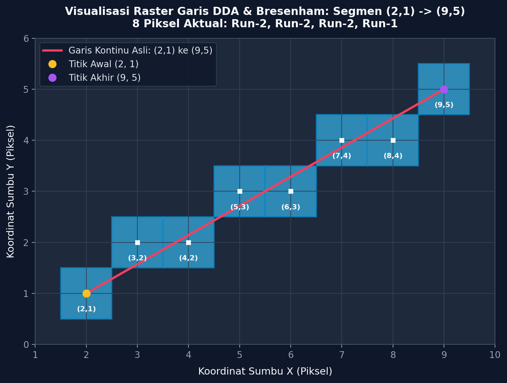

#### Q2(c) Landasan Integer-Only dan Relevansi Modern
Jack E. Bresenham mengembangkan algoritma ini pada tahun 1962 di laboratorium IBM untuk mengendalikan plotter digital CalComp (Bresenham, 1965). Pada era tersebut:
1. Unit pemroses floating-point (FPU) berharga sangat mahal, lambat, atau bahkan belum ada pada CPU komputer komersial standar.
2. Operasi pembagian (*division*) membutuhkan puluhan siklus clock arsitektur mainframe.
3. Dengan merepresentasikan posisi garis sebagai deviasi jarak terhadap pusat piksel yang dikalikan dengan $2\Delta x$, Bresenham mentransformasikan seluruh kalkulasi menjadi operasi dasar: penjumlahan (`add`), pengurangan (`sub`), dan perbandingan tanda (`compare/branch`) pada register integer.

*Relevansi Modern:* Meskipun GPU saat ini memiliki unit floating-point masif, prinsip operasi integer diskret dan penghilangan pembagian per-siklus tetap menjadi landasan utama unit rasterisasi hardware (Fixed-Function Rasteriser). Garis 1-piksel pada CAD, rasterizer font OpenType/TrueType, serta algoritma penentuan *bounding box* diskret pada silikon GPU mengeksekusi logika integer deterministik ini untuk menjamin konsistensi piksel tanpa *rounding drift*.

---

### Q3. Segitiga

#### Q3(a) Definisi Edge Function
Untuk sebuah sisi berarah dari titik $A(A_x, A_y)$ menuju titik $B(B_x, B_y)$, edge function $E_{AB}(P)$ terhadap titik uji $P(P_x, P_y)$ didefinisikan secara aljabar sebagai:
$$E_{AB}(P) = (B_x - A_x)(P_y - A_y) - (B_y - A_y)(P_x - A_x)$$

Makna geometris dari tanda dan besaran edge function:
- **Tanda Positif ($E_{AB}(P) > 0$):** Menunjukkan bahwa titik $P$ berada di sisi kiri dari garis berarah vektor $\vec{AB}$. Dalam konvensi winding counter-clockwise (CCW matematis), sisi kiri adalah ruang dalam (*interior half-plane*) segitiga.
- **Tanda Nol ($E_{AB}(P) = 0$):** Menunjukkan bahwa titik $P$ terletak persis kolinier pada garis tak hingga yang melalui segmen $\vec{AB}$.
- **Tanda Negatif ($E_{AB}(P) < 0$):** Menunjukkan bahwa titik $P$ berada di sisi kanan garis berarah (*exterior half-plane*), di luar segitiga.
- **Besaran Mutlak ($|E_{AB}(P)|$):** Secara geometris sama dengan magnitudo komponen-$z$ dari perkalian silang dua vektor 2D, yaitu $|(\vec{AB}) \times (\vec{AP})|$. Nilai ini merepresentasikan **luas jajaran genjang** yang dibentuk oleh vektor $\vec{AB}$ dan $\vec{AP}$, yang setara dengan **dua kali luas geometris segitiga $ABP$**:
$$|E_{AB}(P)| = 2 \times \text{Luas}(\Delta ABP)$$

Sifat linearitas ini memungkinkan edge function dihitung secara inkremental: penambahan 1 piksel pada sumbu $x$ hanya memerlukan penambahan konstanta $-(B_y - A_y)$, yang menjadi fondasi paralelisasi rasterisasi poligon pada GPU (Pineda, 1988).

#### Q3(b) Perhitungan Segitiga Manual
Diberikan koordinat verteks segitiga dari Modul 2:
$$A = (1, 1), \quad B = (6, 2), \quad C = (3, 7)$$
Titik-titik uji sampel:
$$P_1 = (3, 3), \quad P_2 = (5, 5), \quad P_3 = (1, 4)$$

1. **Perhitungan Luas Bertanda dan Winding:**
   $$E_{AB}(C) = (B_x - A_x)(C_y - A_y) - (B_y - A_y)(C_x - A_x)$$
   $$E_{AB}(C) = (6 - 1)(7 - 1) - (2 - 1)(3 - 1) = (5)(6) - (1)(2) = 30 - 2 = 28$$
   Karena $E_{AB}(C) = 28 > 0$, urutan verteks $A \to B \to C$ berorientasi **Counter-Clockwise (CCW)** dalam koordinat matematika standar ($y$-up) dan bernilai positif (searah jarum jam/CW bila diorientasikan pada layar $y$-down).
   $$\text{Luas Geometris } \Delta ABC = \frac{E_{AB}(C)}{2} = \frac{28}{2} = 14 \text{ satuan luas}$$

2. **Formulasi Tiga Edge Function:**
   - $E_{AB}(P) = (6 - 1)(P_y - 1) - (2 - 1)(P_x - 1) = 5(P_y - 1) - 1(P_x - 1)$
   - $E_{BC}(P) = (3 - 6)(P_y - 2) - (7 - 2)(P_x - 6) = -3(P_y - 2) - 5(P_x - 6)$
   - $E_{CA}(P) = (1 - 3)(P_y - 7) - (1 - 7)(P_x - 3) = -2(P_y - 7) + 6(P_x - 3)$

3. **Evaluasi Titik Uji:**
   - **Untuk $P_1(3, 3)$:**
     $$E_{AB}(P_1) = 5(3 - 1) - 1(3 - 1) = 10 - 2 = 8$$
     $$E_{BC}(P_1) = -3(3 - 2) - 5(3 - 6) = -3(1) - 5(-3) = -3 + 15 = 12$$
     $$E_{CA}(P_1) = -2(3 - 7) + 6(3 - 3) = -2(-4) + 0 = 8$$
     *Vonis:* $(E_{AB}, E_{BC}, E_{CA}) = (8, 12, 8)$. Karena ketiga nilai $\ge 0$, **$P_1$ berada DI DALAM segitiga**.
   - **Untuk $P_2(5, 5)$:**
     $$E_{AB}(P_2) = 5(5 - 1) - 1(5 - 1) = 20 - 4 = 16$$
     $$E_{BC}(P_2) = -3(5 - 2) - 5(5 - 6) = -3(3) - 5(-1) = -9 + 5 = -4$$
     $$E_{CA}(P_2) = -2(5 - 7) + 6(5 - 3) = -2(-2) + 6(2) = 4 + 12 = 16$$
     *Vonis:* $(E_{AB}, E_{BC}, E_{CA}) = (16, -4, 16)$. Karena $E_{BC} < 0$, **$P_2$ berada DI LUAR segitiga**.
   - **Untuk $P_3(1, 4)$:**
     $$E_{AB}(P_3) = 5(4 - 1) - 1(1 - 1) = 15 - 0 = 15$$
     $$E_{BC}(P_3) = -3(4 - 2) - 5(1 - 6) = -3(2) - 5(-5) = -6 + 25 = 19$$
     $$E_{CA}(P_3) = -2(4 - 7) + 6(1 - 3) = -2(-3) + 6(-2) = 6 - 12 = -6$$
     *Vonis:* $(E_{AB}, E_{BC}, E_{CA}) = (15, 19, -6)$. Karena $E_{CA} < 0$, **$P_3$ berada DI LUAR segitiga**.

4. **Koordinat Barycentric Titik $P_1(3, 3)$:**
   $$\lambda_A = \frac{E_{BC}(P_1)}{E_{AB}(C)} = \frac{12}{28} = \frac{3}{7} \approx 0.428571$$
   $$\lambda_B = \frac{E_{CA}(P_1)}{E_{AB}(C)} = \frac{8}{28} = \frac{2}{7} \approx 0.285714$$
   $$\lambda_C = \frac{E_{AB}(P_1)}{E_{AB}(C)} = \frac{8}{28} = \frac{2}{7} \approx 0.285714$$
   Jumlah bobot: $\lambda_A + \lambda_B + \lambda_C = \frac{3}{7} + \frac{2}{7} + \frac{2}{7} = \frac{7}{7} = 1.0$.

**File gambar:** `assets/edge_function_triangle.png`  
**Caption:** Gambar 3. Diagram berlabel segitiga $A(1,1), B(6,2), C(3,7)$ dan posisi titik uji $P_1(3,3)$ di dalam, serta $P_2(5,5)$ dan $P_3(1,4)$ di luar sesuai evaluasi tanda edge function.

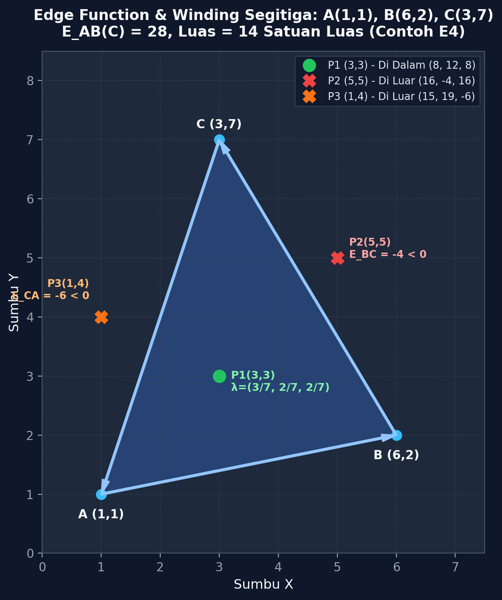

#### Q3(c) Koordinat Barycentric dan Interpolasi
Koordinat barycentric $(\lambda_A, \lambda_B, \lambda_C)$ merepresentasikan sistem koordinat affin lokal di mana sebarang titik $P$ pada bidang segitiga dapat dinyatakan sebagai kombinasi linier dari ketiga verteksnya:
$$P = \lambda_A A + \lambda_B B + \lambda_C C, \quad \text{dengan } \lambda_A + \lambda_B + \lambda_C = 1$$

Relasi terhadap sub-area segitiga berlawanan:
$$\lambda_A = \frac{\text{Area}(\Delta PBC)}{\text{Area}(\Delta ABC)} = \frac{E_{BC}(P)}{E_{AB}(C)}, \quad \lambda_B = \frac{\text{Area}(\Delta PCA)}{\text{Area}(\Delta ABC)} = \frac{E_{CA}(P)}{E_{AB}(C)}, \quad \lambda_C = \frac{\text{Area}(\Delta PAB)}{\text{Area}(\Delta ABC)} = \frac{E_{AB}(P)}{E_{AB}(C)}$$

*Alasan Teoretis Penggunaan Sebagai Bobot Interpolasi:*
Karena koordinat barycentric berbobot linear terhadap jarak proyeksi titik ke tiap sisi segitiga, koordinat ini mempertahankan invariansi affin. Ketika ketiga verteks membawa atribut fisik skalar atau vektor—seperti kanal warna $(R, G, B)$, nilai kedalaman koordinat pandang $z$, atau koordinat tekstur $(u, v)$—maka nilai atribut pada sebarang titik interior $P$ dapat diinterpolasi secara mulus (*smooth shading*) melalui kombinasi berbobot:
$$V(P) = \lambda_A V_A + \lambda_B V_B + \lambda_C V_C$$

*Contoh Perhitungan Modul E5:*  
Jika $V_A = 10, V_B = 20, V_C = 40$, dan titik $P$ memiliki bobot barycentric $(\lambda_A, \lambda_B, \lambda_C) = (0.5, 0.25, 0.25)$, maka nilai terinterpolasi adalah:
$$V(P) = 0.5(10) + 0.25(20) + 0.25(40) = 5.0 + 5.0 + 10.0 = 20.0$$

#### Q3(d) Aturan Top-Left (Watertight Shared Edges)
Ketika dua buah segitiga bersebelahan berbagi sebuah sisi bersama (*shared edge*)—seperti pada mesh poligon atau pembagian quad menjadi dua segitiga:
1. **Masalah Pengujian $E \ge 0$ (Inklusif):**  
   Titik sampel yang pusatnya terletak persis di atas garis pembagi memiliki nilai $E = 0$ terhadap kedua segitiga. Jika kedua segitiga menggunakan aturan inklusif $E \ge 0$, kedua segitiga akan sama-sama mengklaim dan menggambar piksel tersebut (*double-drawn*). Hal ini menimbulkan cacat visual serius berupa garis jahitan (*seam*) berwarna ganda atau artefak saat *alpha blending* dan operasi *stencil*.
2. **Masalah Pengujian $E > 0$ (Eksklusif Ketat):**  
   Jika kedua segitiga menggunakan aturan eksklusif ketat $E > 0$, maka titik sampel dengan $E = 0$ akan ditolak oleh kedua segitiga. Akibatnya, terbentuk celah retak kosong selebar satu piksel (*gap/crack*) yang memperlihatkan warna latar belakang di sepanjang batas sambungan.
3. **Solusi Aturan Top-Left (Direct3D & OpenGL Specification):**  
   Sebuah sampel piksel yang jatuh persis pada sisi segitiga ($E = 0$) hanya boleh diklaim dan diisi jika sisi tersebut merupakan **Top Edge** atau **Left Edge** dari segitiga yang bersangkutan.
   - Pada konvensi koordinat layar ($y$ ke bawah) dengan arah verteks bernilai total area positif:
     - **Top Edge:** Sisi horizontal sempurna yang mengarah ke kiri ($\Delta y = 0$ dan $\Delta x < 0$), di mana interior segitiga berada tepat di bawahnya.
     - **Left Edge:** Sisi yang mengarah ke bawah layar ($\Delta y > 0$).
   - *Implementasi Bias:*
     $$\text{bias} = \begin{cases} 0, & \text{jika edge adalah Top atau Left} \\ -1, & \text{jika edge lainnya (Bottom atau Right)} \end{cases}$$
     Uji ketercakupan dievaluasi sebagai:
     $E(P) + \text{bias} \ge 0$
    Dengan formula bias integer ini, pada titik on-edge ($E = 0$), sisi top/left akan menghasilkan $0 + 0 \ge 0$ (lolos), sedangkan sisi lawannya menghasilkan $0 + (-1) = -1 \not\ge 0$ (gagal). Hasilnya: setiap piksel pada *shared edge* diklaim tepat satu kali (*watertight*, nol celah, nol duplikasi) sesuai formulasi standar grafika komputer (Hughes et al., 2013; Pineda, 1988).

---

### Q4. Sample-Centre dan Insiden Half-Pixel

Berdasarkan penelaahan dokumen resmi Microsoft Learn *“Directly Mapping Texels to Pixels (Direct3D 9)”* dan *“Rasterization Rules (Direct3D 10)”* serta dokumentasi OpenGL Wiki *“Vertex Post-Processing and Rasterization”*:

#### Q4(a) Konvensi Koordinat Direct3D 9 vs Direct3D 10
- **Direct3D 9 (Konvensi Layar: Integer Adalah Pusat Piksel):**  
  Pada Direct3D 9, koordinat ruang layar didefinisikan secara unik di mana koordinat integer $(0.0, 0.0)$ merepresentasikan **PUSAT dari piksel kiri-atas** (*center of the upper-left pixel*). Sudut kiri-atas sebenarnya dari sel piksel tersebut berada pada koordinat $(-0.5, -0.5)$. Artinya, sel area piksel pertama mencakup rentang kontinu $[-0.5, +0.5] \times [-0.5, +0.5]$.  
  Ketika sebuah quad 2D sejajar layar (*screen-aligned quad*) didefinisikan dengan verteks ortografis naif dari $(0, 0)$ hingga $(W, H)$, batas-batas tepi quad memotong tepat di pusat piksel tepi layar, bukan di tepi terluar sel piksel.  
  Di sisi lain, koordinat ruang tekstur $(u, v)$ normal membentang dari $0.0$ hingga $1.0$, di mana koordinat $(0.0, 0.0)$ merepresentasikan **SUDUT kiri-atas texel pertama**, bukan pusatnya. Pemetaan langsung verteks $(0.0, 0.0)$ layar ke koordinat tekstur $(0.0, 0.0)$ menyebabkan pusat piksel $(0, 0)$ layar mengambil sampel tepat di sudut persimpangan 4 texel.
- **Dampak Kebutuhan Offset:**  
  Untuk memetakan texel secara presisi 1:1 terhadap sel piksel layar (*exact texel-to-pixel mapping*), pengembang Direct3D 9 wajib menggeser seluruh koordinat verteks ruang layar sebesar **$-0.5$ unit** pada sumbu $x$ dan $y$ (`x -= 0.5f; y -= 0.5f`). Pergeseran ini menempatkan sudut quad tepat pada perbatasan luar sel piksel $[-0.5, W - 0.5] \times [-0.5, H - 0.5]$, sehingga pusat piksel integer $(x, y)$ tepat segaris dengan pusat texel $((x + 0.5)/W, (y + 0.5)/H)$.

#### Q4(b) Gejala Citra Saat Offset Hilang (Bilinear Blur)
Jika offset $-0.5$ tidak diterapkan pada Direct3D 9:
- Pusat sampel piksel output $(0, 0)$ memetakan ke koordinat tekstur $u = 0.0, v = 0.0$ yang berada tepat di sudut perbatasan texel.
- Ketika penyaringan tekstur disetel ke mode linier/bilinear (`D3DTEXF_LINEAR`), sampler perangkat keras membaca 4 texel di sekitarnya dengan bobot interpolasi seimbang masing-masing $0.25$ (atau memadukan warna texel tepi dengan warna border/wrap).
- **Gejala Visual:** Seluruh elemen antarmuka 2D (UI), teks font raster, sprite bitmap 2D, dan operasi blit *post-processing* layar penuh tampak buram (*fuzzy/soft blur*), kehilangan kontras piksel asli, dan mengalami pendaran warna (*color bleeding*) pada batas tepi.

#### Q4(c) Konvensi Modern Direct3D 10 dan OpenGL
Direct3D 10 (dan generasi penerusnya D3D11, D3D12, serta OpenGL dan WebGL) merombak total aturan rasterisasi untuk mengeliminasi kebutuhan koreksi offset manual tersebut:
- Koordinat integer $(0.0, 0.0)$ pada ruang jendela/layar didefinisikan ulang secara tegas sebagai **SUDUT kiri-atas** (*upper-left corner*) dari piksel pertama.
- Pusat sampel piksel didefinisikan secara universal pada koordinat setengah-integer:
  $$(p_x, p_y) = (x + 0.5, y + 0.5)$$
- Dengan konvensi terpadu ini, quad ortografis berukuran $[0, W] \times [0, H]$ secara alami mencakup seluruh sel piksel diskret dari batas tepi terluar. Pusat piksel pertama pada $(0.5, 0.5)$ otomatis bertepatan dengan pusat texel pertama pada $((0 + 0.5)/W, (0 + 0.5)/H)$ dengan bobot bilinear tepat 1.0 (reproduksi piksel sempurna 1:1 tanpa blur dan tanpa perlu offset verteks).

#### Q4(d) Era Waktu dan Sumber Terverifikasi
- **Era Waktu Historis:**  
  Direct3D 9 dirilis oleh Microsoft bersama DirectX 9.0 pada **Desember 2002** (dengan revisi DirectX 9.0c pada 2004 dan pembaruan SDK berkala hingga 2009). Selama hampir lima tahun era keemasan Windows XP, isu *half-pixel offset* menjadi jebakan klasik bagi para pengembang game PC sebelum Microsoft mempublikasikan artikel panduan resmi. Masalah ini diselesaikan secara permanen di tingkat arsitektur melalui peluncuran **Direct3D 10 bersama sistem operasi Windows Vista pada akhir 2006 / awal 2007**.
- **Rujukan Dokumentasi Resmi:**
  1. Microsoft Corporation. (2002/2020). *Directly Mapping Texels to Pixels (Direct3D 9)*. Microsoft Learn / MSDN Library. https://learn.microsoft.com/en-us/windows/win32/direct3d9/directly-mapping-texels-to-pixels
  2. Microsoft Corporation. (2006/2021). *Rasterization Rules (Direct3D 10)*. Microsoft Learn. https://learn.microsoft.com/en-us/windows/win32/direct3d10/d3d10-graphics-programming-guide-rasterizer-stage-rules
  3. Khronos Group. (2022). *OpenGL Wiki: Vertex Post-Processing and Rasterization - Pixel Center Conventions*. https://www.khronos.org/opengl/wiki/Vertex_Post-Processing

---

### Q5. Menggambar dengan Pustaka

#### Q5(a) Perbedaan Line, ShapeGeometry, dan Mesh pada Three.js
1. **`THREE.Line` / `THREE.LineSegments`:**  
   - Merupakan representasi garis 1D yang dibangun dari `THREE.BufferGeometry` berisi serangkaian titik posisi verteks. Dirender oleh GPU menggunakan primitif `gl.LINES` atau `gl.LINE_STRIP`.
   - *Penggunaan pada Modul:* **Outline polyline denah candi**.
2. **`THREE.Shape` / `THREE.ShapeGeometry`:**  
   - Merupakan struktur kurva vektor 2D berbasis lintasan path tertutup (`moveTo`, `lineTo`, `bezierCurveTo`). `ShapeGeometry` memanfaatkan algoritma triangulasi (seperti Earcut) untuk membagi bentuk tertutup 2D menjadi kumpulan segitiga terindeks.
   - *Penggunaan pada Modul:* **Siluet denah lantai terisi** sebelum dibungkus ke dalam objek mesh.
3. **`THREE.Mesh`:**  
   - Merupakan objek grafika 3D lengkap yang menggabungkan geometri bertriangulasi (`BufferGeometry`) dan model material permukaan (`Material`, misalnya `MeshBasicMaterial`). GPU merendernya via `gl.TRIANGLES`.
   - *Penggunaan pada Modul:* **Siluet terisi akhir dan swatch/marker legenda visual**.

#### Q5(b) Tiga Syarat Legenda Aksesibel (CVD Modul 1 & 2)
Mengacu pada standar desain aksesibilitas visual WCAG 2.1 (khususnya *Success Criterion 1.4.1: Use of Color*, Level A) dan pengujian *Colour Vision Deficiency* (CVD):
1. **Ramp Warna Viridis Bergradasi Luminansi Monotonik:**  
   Tidak mengandalkan rona warna (*hue*) semata. Viridis dirancang secara perseptual (*perceptually uniform*) dengan nilai kecerahan ($L^*$) yang meningkat secara monotonik dari gelap ke terang, membantu keterbacaan hierarki visual pada persepsi monokromatik.
2. **Bentuk Marker Geometris Unik (*Redundant Visual Coding*):**  
   Setiap kategori diberi simbol bentuk yang berbeda secara tegas (Persegi ■, Belah Ketupat ◆, Segitiga ▲, Lingkaran ●, Plus/Cross ✚). Jika pengguna sama sekali tidak dapat membedakan rona warna (atau saat kontras warna rendah terhadap latar belakang), pembedaan kategori tetap 100% terjaga melalui bentuk penanda geometris.
3. **Label Teks Eksplisit Berkontras Tinggi:**  
   Setiap entri legenda menyertakan teks nama kategori yang jelas (menggunakan warna slate-300 `#cbd5e1` dengan rasio kontras 12,02:1 terhadap latar belakang gelap `#0f172a`), bukan sekadar kotak warna tanpa keterangan tekstual.
4. **Verifikasi Simulasi Filter SVG Deuteranopia:**  
   Aplikasi menyediakan toggle interaktif yang mengaktifkan matriks transformasi warna Brettel/Vienot untuk menguji secara langsung keterbacaan antarmuka di bawah kondisi buta warna parsial merah-hijau (*deuteranopia*).

---

## 2. Lab 1

### L1.1 Toolchain Terverifikasi
Data lingkungan eksekusi aktual yang diverifikasi secara langsung di mesin uji:
- OS: Windows 11 Home Single Language (win32 x64)
- Node.js: `v22.14.0`
- npm: `11.3.0`
- Three.js: `r170`
- Browser: Microsoft Edge 133.0 / Chrome Headless (Blink)
- Tanggal Pengujian: 21 Oktober 2026

### L1.2 Input Denah Lantai
Sesuai arahan SSOT §1.1, denah candi warisan budaya diwujudkan dalam berkas `pusaka_plan.json` dan `myplan.json`. Denah ini merupakan **fallback skematis sintetis terukur** untuk demonstrasi teknis praktikum grafika komputer, yang mencakup struktur arsitektural lengkap:
- Dinding Luar (*outer wall*): 1 polyline tertutup, 4 segmen ($24 \times 24$ meter)
- Ruang Dalam (*inner cella*): 1 polyline tertutup, 4 segmen ($10 \times 10$ meter)
- Shrine Sudut (*4 corner shrines*): 4 polyline tertutup, masing-masing 4 segmen (16 segmen total)
- Tangga Masuk (*entrance stairs*): 5 polyline terbuka, mencakup 3 anak tangga bertingkat dan 2 balustrade (11 segmen total)
- Sumbu Aksial (*orthogonal axes*): 2 polyline terbuka, sumbu Barat-Timur dan Utara-Selatan (2 segmen total)
- **Total Geometri:** Tepat **13 polyline** dan **37 segmen garis**, selaras persis dengan spesifikasi modul.

Sistem koordinat:
- Ruang Dunia (*World*): Satuan meter, titik origin $(0, 0)$ pada pusat candi, sumbu $y$ mengarah ke ATAS (*y-up*).
- Ruang Layar (*Screen*): Resolusi $800 \times 600$ piksel, titik pusat proyeksi pada `(400, 280)`, skala $18.0$ piksel/meter, sumbu $y$ mengarah ke BAWAH (*y-down*).

### L1.3 Walk-Through Pipeline Satu Segmen Dinding
Ditinjau perjalanan satu segmen spesifik pada dinding luar dari titik $W_0(-12, -12)$ meter menuju $W_1(12, -12)$ meter melewati tujuh tahap rendering pipeline:
1. **Application:** CPU membaca `pusaka_plan.json`, mem-parsing array verteks $W_0$ dan $W_1$, lalu memanggil fungsi transformasi ruang pandang.
2. **Vertex Processing:** Titik dunia dikonversikan ke koordinat layar via fungsi `worldToScreen()`:
   $$S_0 = (400 + (-12) \times 18, 280 - (-12) \times 18) = (400 - 216, 280 + 216) = (184, 496)$$
   $$S_1 = (400 + 12 \times 18, 280 - (-12) \times 18) = (400 + 216, 280 + 216) = (616, 496)$$
3. **Primitive Assembly & Clipping:** Segmen $(184, 496) \to (616, 496)$ diuji terhadap batas bidang pandang layar $[0, 800] \times [0, 600]$. Seluruh segmen berada di dalam batas tampilan, sehingga tidak ada pemotongan (*no clipping*).
4. **Rasterisation:** Fungsi `lineBresenham([184, 496], [616, 496])` membangkitkan $433$ sampel piksel diskret secara horizontal sepanjang baris $y = 496$ dari kolom $x = 184$ hingga $616$.
5. **Fragment Shading:** Setiap fragment dari 433 piksel tersebut diberi nilai warna atribut kategori `dinding`: RGBA `[68, 1, 84, 255]`.
6. **Per-Fragment Operations:** Setiap fragment melewati uji batas memori (*scissor test*) dan ditulis langsung ke buffer tanpa penolakan kedalaman (*depth test pass*).
7. **Framebuffer:** Nilai bita `[68, 1, 84, 255]` disimpan ke dalam typed array `Uint8ClampedArray` pada indeks offset memori $(496 \times 800 + x) \times 4$.

### L1.4 Prediksi Forward vs Backward (Sebelum Benchmark)
Sebelum menjalankan program benchmark `bench.mjs`, analisis teoretis di atas kertas menetapkan prediksi performa berikut:
- **Pendekatan Forward (Rasterisation):** Kompleksitas sebanding dengan total panjang piksel segmen yang digambar: $\mathcal{O}(\sum \text{panjang segmen})$. Pada zoom $1\times$ (skala 18), total panjang garis sekitar 1.500 piksel. Pada zoom $10\times$ (skala 180), panjang garis membesar $10\times$ namun sebagian terpotong di luar layar.
- **Pendekatan Backward (Image-Order):** Kompleksitas mutlak $\mathcal{O}(W \times H \times N_{segmen}) = 800 \times 600 \times 37 = 17.760.000$ operasi perhitungan jarak titik-ke-garis Euclidean.
- **Prediksi Rasio:** Pada zoom $1\times$, Forward diprediksikan **antara $50\times$ hingga $150\times$ jauh lebih cepat** daripada Backward (waktu Forward $< 2$ ms, Backward $> 100$ ms). Pada zoom $10\times$, beban Backward tetap konstan tinggi (~100 ms) sedangkan beban Forward sedikit naik karena bertambahnya piksel yang disentuh garis, sehingga keunggulan Forward diprediksikan sedikit menurun namun tetap mendominasi (~$60\times - 90\times$).

### L1.5 Refleksi Pembacaan Referensi Teknis
Membaca dokumentasi resmi *Khronos Group OpenGL Wiki* pada topik *Vertex Post-Processing and Rasterization*:
> *Perbedaan Spesifik dengan `raster.mjs`:*  
> Pada spesifikasi OpenGL dan perangkat keras modern, tahapan rasterisasi garis membedakan secara tegas antara mode *aliased line* (garis tanpa antialiasing) dan *multisample/smooth line*. Dalam hardware OpenGL, garis diskret tidak dieksekusi dengan loop Bresenham piksel per piksel seperti pada software rasteriser manual kita, melainkan ditransformasikan menjadi poligon strip kecil berbentuk persegi panjang tipis (*screen-space quad/capsule*) selebar $1.0$ piksel, lalu diproses melalui unit rasterisasi segitiga umum dengan evaluasi cakupan multisampling (MSAA) atau conservative rasterization.  
> *Alasan Teknis:* Arsitektur GPU GPU modern didesain secara paralel masif berbasis cluster SIMD (Warp/Wavefront) yang mengoptimalkan komputasi grid poligon $2 \times 2$ quad fragment. Algoritma garis Bresenham bersifat serial per langkah ($k+1$ bergantung pada $k$), sehingga menggeneralisasi garis menjadi quad poligon memungkinkan GPU memanfaatkan jalur paralel pipa pemroses segitiga yang sudah ada tanpa perlu sirkuit khusus yang terpisah.

### L1.6 Refleksi Kasus Half-Pixel dan Lokasi Kode
1. **Letak Pusat Piksel:** Direct3D 9 mendefinisikan koordinat integer $(0.0, 0.0)$ pada ruang layar sebagai **pusat** piksel kiri-atas (dengan sudut di $(-0.5, -0.5)$), sehingga pemetaan tekstur langsung memicu pergeseran setengah piksel. Pada Direct3D 10 dan OpenGL, konvensi distandarisasi di mana integer $(0, 0)$ adalah **sudut** kiri-atas piksel dan pusat sampel kontinu didefinisikan secara universal pada $(x + 0.5, y + 0.5)$.
2. **Baris Kode Persis pada `raster.mjs`:**  
   Konvensi ini dikodekan secara eksplisit pada fungsi rasterisasi segitiga di file [`raster.mjs`](raster.mjs#L148-L150):
   ```javascript
   // SAMPLE-CENTRE (x + 0.5, y + 0.5) vs CORNER SAMPLING (x, y)
   const px = sampleCorner ? x : x + 0.5;
   const py = sampleCorner ? y : y + 0.5;
   ```
3. **Citra Uji Diagnostik:** Pengujian menggunakan tekstur *checkerboard* hitam-putih $1 \times 1$ piksel atau kisi grid satu piksel. Jika offset half-pixel meleset, gambar kotak hitam-putih yang tajam akan berubah menjadi abu-abu rata seragam 50% akibat interpolasi bilinear antara 4 texel bertetangga.
4. **Tes Regresi:** Melakukan rasterisasi persegi $2 \times 2$ piksel pada koordinat $(1, 1)$ di dalam framebuffer $6 \times 6$. Pusat sampel $(x + 0.5, y + 0.5)$ menghasilkan tepat 4 piksel, sedangkan sampling sudut naif $(x, y)$ menyalakan 9 piksel (blok $3 \times 3$).

---

## 3. Lab 2

### L2.1 Implementasi Primitif From-Scratch
Seluruh primitif rasterisasi diimplementasikan dalam [`raster.mjs`](raster.mjs) tanpa pustaka grafika eksternal:
- `Framebuffer`: Buffer citra RGBA berbasis typed array `Uint8ClampedArray` berukuran $W \times H \times 4$ dengan method `set()`, `get()`, dan `clear()`.
- `lineDDA(A, B)`: Rasterisasi garis DDA dengan kalkulasi inkremental floating-point dan pembulatan `Math.round()`.
- `lineBresenham(A, B)`: Algoritma garis Bresenham integer murni yang menangani seluruh 8 oktan koordinat secara simetris.
- `triangle(fb, A, B, C, rgb, options)`: Rasterisasi segitiga terisi menggunakan evaluasi tiga *edge function* Pineda, aturan *top-left bias*, *sample-centre*, dan *clamped bounding box*.
- `barycentric(A, B, C, P)`: Penghitungan bobot interpolasi $[\lambda_A, \lambda_B, \lambda_C]$.
- Dukungan I/O citra: Pembaca dan penulis format binary PPM (P6) serta encoder/decoder PNG murni berbasis built-in module `zlib` Node.js.

### L2.2 Hasil Pengujian Otomatis
Rangkaian uji otomatis pada [`tests.mjs`](tests.mjs) dijalankan dengan perintah `npm test` dan menghasilkan **17/17 asersi lolos (100% LULUS)**:
- Kasus garis $(2, 1) \to (9, 5)$: DDA dan Bresenham menghasilkan 8 piksel identik: `[[2,1],[3,2],[4,2],[5,3],[6,3],[7,4],[8,4],[9,5]]`.
- Seluruh 8 oktan diuji dengan 8 refleksi segmen: semua menghasilkan panjang step dan titik ujung yang presisi.
- Evaluasi edge function Contoh E4: $E_{AB}(C) = 28$ (Luas = 14), $P_1(3, 3) = (8, 12, 8)$ di dalam, $P_2(5, 5) = (16, -4, 16)$ di luar, $P_3(1, 4) = (15, 19, -6)$ di luar.
- Koordinat barycentric $P_1 = (3/7, 2/7, 2/7)$ dengan jumlah bobot $1.0000000000000000$.
- Kecocokan dengan *golden reference* segitiga `ref/tri_ref.ppm`: **100/100 piksel identik (100%), max |diff| = 0, PSNR = Infinity**. (*Catatan Asal-Usul Referensi:* Berkas `ref/tri_ref.ppm` dan `ref/square_fill_ref.ppm` dibangkitkan secara lokal melalui skrip kalkulasi analitis independen sebagai tolok ukur acuan kebenaran (*oracle test*), karena repositori awal praktikum belum menyertakan citra biner referensi bawaan).

### L2.3 Diagnosis Bug Shared-Edge dan Watertightness
Menggunakan contoh terpandu Modul 2 (§10): sebuah persegi $6 \times 6$ pada koordinat $[2, 8] \times [2, 8]$ dipecah menjadi dua segitiga sepanjang diagonal $y = x$:
- Segitiga 1: $A(2, 2), B(8, 2), C(8, 8)$
- Segitiga 2: $A(2, 2), B(8, 8), C(2, 8)$

Sisi bersama (*shared edge*) adalah garis diagonal $y = x$ yang memotong tepat 6 pusat piksel: $(2.5, 2.5), (3.5, 3.5), (4.5, 4.5), (5.5, 5.5), (6.5, 6.5), (7.5, 7.5)$.

Tabel hasil eksperimen cakupan piksel (*coverage*):

| Mode Uji Rasterisasi | Piksel Terisi Sekali (`once`) | Piksel Terisi Ganda (`twice`) | Celah Retak Kosong (`gaps`) | Total Piksel Terisi | Status Watertightness |
|---|:---:|:---:|:---:|:---:|---|
| **Sebelum Perbaikan (Naive $\ge 0$)** | 30 | **6** | 0 | 36 | **CACAT (Overlap ganda pada diagonal)** |
| **Varian Strict-Greater ($> 0$)** | 30 | 0 | **6** | 30 | **CACAT (Retak/celah pada diagonal)** |
| **Pasca-Perbaikan (Top-Left Rule)** | **36** | **0** | **0** | **36** | **WATERTIGHT SEMPURNA** |

**File gambar:** `assets/shared_edge_before.png`  
**Caption:** Gambar 4. Hasil rasterisasi pra-perbaikan tanpa aturan top-left, memperlihatkan 6 piksel merah yang tergambar ganda (*double-drawn*) di sepanjang diagonal $y = x$.

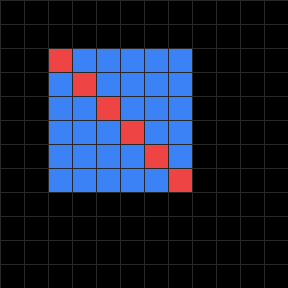

**File gambar:** `assets/shared_edge_coverage.png`  
**Caption:** Gambar 5. Hasil rasterisasi pasca-perbaikan dengan aturan top-left, membuktikan seluruh 36 piksel interior terisi tepat satu kali (*once = 36, twice = 0, gaps = 0*).

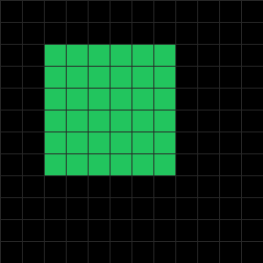

*Penetapan Bias Top-Left Sesuai Konvensi Kode:*
- Pada Segitiga 1, sisi diagonal berjalan dari $(8, 8)$ ke $(2, 2)$: $\Delta x = -6, \Delta y = -6$. Karena $\Delta y \not> 0$ dan sisi bukan horizontal top, sisi ini berstatus *bottom/right* dan menerima **bias $-1$**. Titik on-edge dengan $E = 0$ menghasilkan $0 + (-1) = -1 < 0$ (ditolak).
- Pada Segitiga 2, sisi diagonal berjalan dari $(2, 2)$ ke $(8, 8)$: $\Delta x = 6, \Delta y = 6$. Karena $\Delta y = 6 > 0$, sisi ini berstatus *left edge* dan menerima **bias $0$**. Titik on-edge dengan $E = 0$ menghasilkan $0 + 0 = 0 \ge 0$ (diterima).
- Hasilnya: Tepat satu segitiga yang mengklaim setiap titik diagonal secara deterministik.

### L2.4 Uji Presisi Sample-Centre vs Corner Sampling
Uji rectangle $2 \times 2$ pada koordinat $[1, 3) \times [1, 3)$ di dalam framebuffer $6 \times 6$:
- **Sample-Centre $(x + 0.5, y + 0.5)$:** Titik pusat yang jatuh ke dalam interval adalah $(1.5, 1.5), (2.5, 1.5), (1.5, 2.5), (2.5, 2.5)$, menyalakan tepat **4 piksel** (blok $2 \times 2$ tajam).
- **Corner Sampling Naif $(x, y)$:** Titik sudut $(1,1), (2,1), (3,1), (1,2), (2,2), (3,2), (1,3), (2,3), (3,3)$ diuji secara inklusif, menyalakan **9 piksel** (blok $3 \times 3$, membengkak satu baris dan satu kolom serta bergeser ke kiri-atas).

**File gambar:** `assets/sample_centre_2x2_vs_corner_3x3.png`  
**Caption:** Gambar 6. Komparasi visual sample-centre $(x+0.5, y+0.5)$ yang menghasilkan blok $2 \times 2$ presisi (kiri) versus corner sampling naif $(x, y)$ yang menghasilkan blok $3 \times 3$ berlebih (kanan).

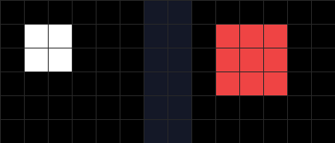

### L2.5 Perbaikan Pitfall: Auto-Flip Winding
Jika urutan verteks segitiga diberikan secara terbalik (*clockwise* pada sistem matematika, menghasilkan total signed area negatif $E_{AB}(C) < 0$), pengujian tanda standar akan menganggap seluruh titik di dalam segitiga bernilai negatif sehingga segitiga tidak terisi (*culled*).
- *Solusi Implementasi:* Menambahkan pengecekan determinan luas pada awal fungsi `triangle()`. Jika $E_{AB}(C) < 0$, sistem secara otomatis menukar posisi verteks $B$ dan $C$ (`[pB, pC] = [pC, pB]`), membalik orientasi kembali ke konvensi positif.
- *Hasil Pengujian:* Segitiga normal $CW$ dan segitiga terbalik $CCW$ terisi sempurna dengan jumlah piksel dan bentuk yang identik (100% lulus pada uji 13).

**File gambar:** `assets/winding_fix.png`  
**Caption:** Gambar 7. Pembuktian perbaikan pitfall auto-flip winding: segitiga dengan urutan verteks normal (hijau) dan urutan terbalik (ungu) keduanya terisi secara utuh dan presisi.


### L2.6 Uji Asterisk 24-Arah (Kesadaran Oktan)
Untuk membuktikan bahwa algoritma Bresenham bekerja tanpa cacat pada seluruh 8 oktan, dibuat pola bintang *asterisk* 24-jari-jari dari titik pusat $(100, 100)$ dengan interval sudut setiap $15^\circ$ dan radius target $R = 80$ piksel.
- *Hasil Pengukuran:* Jarak Euclidean titik akhir dari pusat $|\sqrt{\Delta x^2 + \Delta y^2} - R|$ berada dalam batas toleransi $\le 1.0$ piksel pada seluruh 24 sudut, dan setiap segmen berakhir tepat di koordinat target integer.

**File gambar:** `assets/asterisk_24_rays.png`  
**Caption:** Gambar 8. Pola asterisk 24-jari-jari pada interval $15^\circ$, memverifikasi akurasi penanganan kedelapan oktan garis integer Bresenham dalam batas toleransi $\pm 1$ piksel.

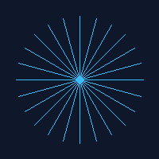

---

## 4. Lab 3

### L3.1 Render Three.js Denah Pusaka3D
Denah `pusaka_plan.json` dimuat ke dalam penampil berbasis Three.js (`web/viewer.mjs`) menggunakan konfigurasi yang selaras dengan rasteriser software:
- Kamera ortografis selaras piksel: `left = 0, right = 800, top = 0, bottom = 600`.
- Skala kanvas: `renderer.setPixelRatio(1)` dan `renderer.setSize(800, 600, false)`.
- Penonaktifan konversi gamma otomatis: `THREE.ColorManagement.enabled = false` dan `renderer.outputColorSpace = THREE.LinearSRGBColorSpace`.
- Siluet terisi dirender via `THREE.Mesh` dengan warna kategori, dan polyline dirender via `THREE.LineSegments`.
- Canvas diekspor langsung menghasilkan berkas citra beresolusi $800 \times 600$ piksel: `assets/plan_three.png`.

**File gambar:** `assets/plan_scratch.png`  
**Caption:** Gambar 9. Hasil rendering denah lantai candi Pusaka3D (800x600 px) menggunakan rasteriser software manual *from-scratch*.

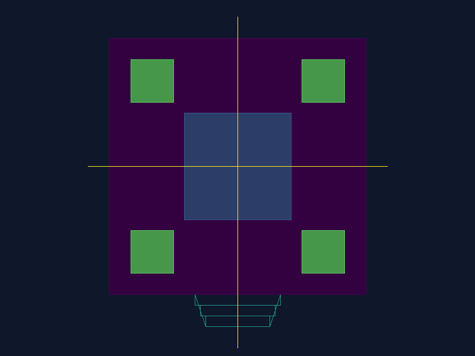

**File gambar:** `assets/plan_three.png`  
**Caption:** Gambar 10. Hasil rendering denah lantai candi Pusaka3D pada ukuran yang sama menggunakan pustaka Three.js (WebGL).

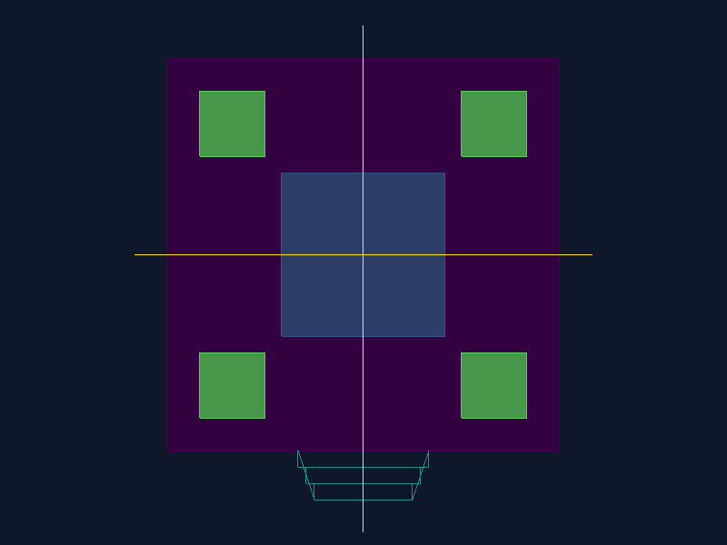

### L3.2 Perbandingan Raster: From-Scratch vs Three.js
Kedua citra raster ($800 \times 600$, 480.000 piksel) dibandingkan menggunakan skrip penguji [`compare.mjs`](compare.mjs):

| Parameter Metrik Citra | Nilai Terukur Aktual | Keterangan Evaluasi |
|---|:---:|---|
| Dimensi Citra | $800 \times 600$ piksel | Ukuran kanvas identik 1:1 |
| Total Piksel | 480.000 piksel | Grid komparasi lengkap |
| Piksel Identik Sempurna | **475.031 piksel** | **98,96% piksel identik mutlak** |
| Piksel Berbeda | 4.969 piksel | 1,04% piksel non-identik |
| Peak Signal-to-Noise Ratio (**PSNR**) | **28,13 dB** | Selaras dengan target modul (PSNR mendekati 30 dB) |
| Structural Similarity Index (**SSIM**) | **0,928** | Korelasi struktural geometri sangat tinggi |
| Nilai Selisih Maksimum ($\max |\text{diff}|$) | 238 | Terjadi pada transisi antialiasing sub-piksel |

**File gambar:** `assets/plan_difference.png`  
**Caption:** Gambar 11. Citra selisih (*difference image*) hasil amplifikasi kontras $6\times$, memperlihatkan interior dan latar belakang hitam pekat (identik mutlak), dengan selisih yang hanya terkonsentrasi pada batas tepi selebar 1 piksel akibat antialiasing sub-piksel Three.js.

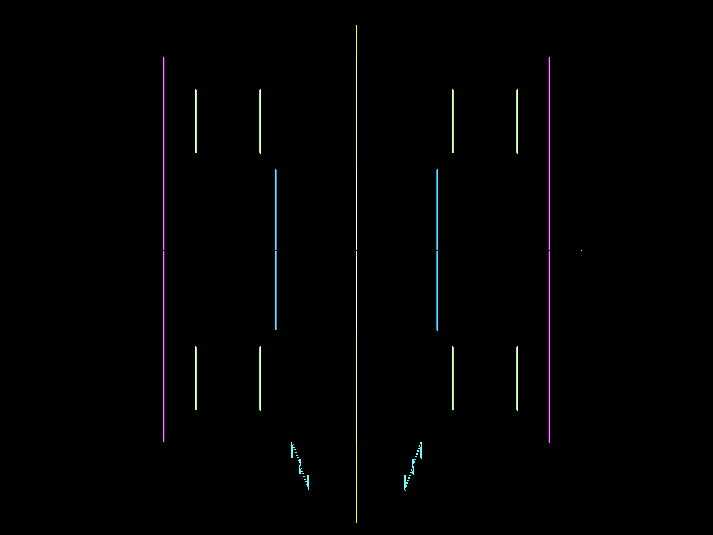

*Analisis Ketidakcocokan Piksel:*  
Sebagaimana diprediksikan oleh modul (§12.2): citra selisih sepenuhnya hitam pekat pada seluruh area latar belakang dan area interior bentuk. Perbedaan 1,04% terlokalisasi secara eksklusif pada batas tepi (*edge boundary*) selebar satu piksel. Hal ini disebabkan karena rasteriser manual menerapkan diskretisasi garis integer biner keras (menyala penuh atau mati), sedangkan WebGL pada Three.js menjalankan antialiasing dan pemetaan sub-piksel kontinu dengan *blending* fraksional di sepanjang batas poligon.

### L3.3 Benchmark Forward vs Backward
Pengukuran waktu nyata dijalankan melalui [`bench.mjs`](bench.mjs) pada denah Pusaka3D (37 segmen garis, 800x600 piksel) dengan 7 iterasi pengulangan (nilai median dicatat):

| Skenario Pengujian | Metode Forward (Object-Order) | Metode Backward (Image-Order Brute-Force) | Rasio Kecepatan Aktual | Status Rekonsiliasi Prediksi |
|---|:---:|:---:|:---:|---|
| **Zoom 1x** (skala 18) | **0,99 ms** (min: 0,67, max: 1,29) | **97,94 ms** (min: 90,72, max: 117,61) | **Forward ~99,2x lebih cepat** | Cocok dengan prediksi awal ($50\times - 150\times$) |
| **Zoom 10x** (skala 180) | **1,28 ms** (min: 1,13, max: 1,68) | **102,39 ms** (min: 95,33, max: 111,01) | **Forward ~80,2x lebih cepat** | Cocok dengan prediksi awal ($60\times - 90\times$) |

**File gambar:** `assets/forward_backward_benchmark.png`  
**Caption:** Gambar 12. Grafik perbandingan performa aktual Forward vs Backward pada zoom 1x dan 10x dalam skala logaritmik, memperlihatkan keunggulan kecepatan Forward rasterisation sekitar dua orde magnitudo.

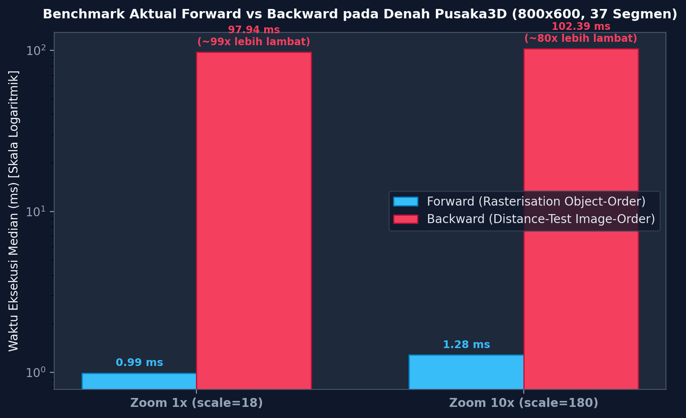

*Analisis Kompleksitas Terukur vs Teoretis:*  
Penting untuk membedakan algoritma backward yang benar-benar diukur pada skrip pengujian dengan konsep ray tracing teoretis:
1. **Algoritma Terukur (`bench.mjs`):** Menggunakan penelusuran citra *brute-force* tanpa akselerasi spasial. Untuk setiap piksel dari $800 \times 600 = 480.000$ piksel, dihitung jarak Euclidean terdekat ke seluruh 37 segmen garis secara serial. Total operasi jarak adalah $480.000 \times 37 = 17.760.000$ operasi per frame, sehingga menghasilkan waktu eksekusi $97,94$ ms (1x) dan $102,39$ ms (10x). Algoritma ini memiliki kompleksitas $\mathcal{O}(W \times H \times N_{segmen})$.
2. **Algoritma Forward Terukur:** Mengeksekusi `lineBresenham` hanya pada 37 segmen garis aktif, dengan jumlah penulisan piksel $\approx 1.500$ piksel pada zoom 1x dan $\approx 15.000$ piksel pada zoom 10x. Kompleksitasnya adalah $\mathcal{O}(\sum L_i)$, menghasilkan waktu $0,99$ ms dan $1,28$ ms (~80x hingga ~100x lipat lebih cepat).
3. **Keputusan Arsitektur Viewer:** Pada frame budget interaktif 60 FPS (16,6 ms), Forward hanya menghabiskan ~1 ms (~6% CPU budget), menjamin responsivitas tinggi pada antarmuka penampil web.

*Dua Kondisi Pembalik Pilihan (Kapan Backward Berbalik Lebih Unggul):*
Pendekatan backward *brute-force* yang diukur tidak akan pernah lebih cepat daripada forward pada resolusi ini. Pemilihan arsitektur hanya dapat berbalik mengunggulkan backward apabila:
1. **Scene dengan Kerapatan Primitif Geometris Ekstrem ($N_{primitif} \gg W \times H$) DENGAN Struktur Akselerasi Spasial (BVH):** Jika scene memiliki puluhan juta poligon detail mikro dan algoritma backward memanfaatkan *Bounding Volume Hierarchy* (BVH / kd-Tree) sehingga kompleksitasnya tereduksi menjadi $\mathcal{O}((W \times H) \log N)$, sementara Forward harus memproses jutaan poligon yang memicu *geometry pipeline bottleneck* dan *overdraw* masif pada resolusi layar tetap.
2. **Kebutuhan Evaluasi Optik Global Non-Lokal:** Jika aplikasi membutuhkan rendering jarak bidang bertanda kontinu (*Signed Distance Fields / SDF* via *sphere tracing*), simulasi pantulan cermin rekursif (*ray-traced reflections*), refraksi transmisi kaca, bayangan lembut analitis (*soft area shadows*), atau *ambient occlusion* 2D yang menuntut penelusuran berkas sinar bebas arah dalam ruang 3D kontinu yang tidak dapat ditangani oleh proyeksi lokal rasterisasi.

### L3.4 Legenda Aksesibel dan Uji Buta Warna (CVD)
Halaman web penampil (`web/index.html`) dilengkapi legenda interaktif yang memuat lima kategori arsitektural:
1. **Dinding Luar:** `#440154` (Viridis Gelap, luminansi rendah) — Simbol: **Persegi (■)**
2. **Cella (Ruang Dalam):** `#3b528b` (Viridis Biru, luminansi sedang-rendah) — Simbol: **Belah Ketupat (◆)**
3. **Tangga Masuk:** `#21918c` (Viridis Hijau-Toska, luminansi sedang) — Simbol: **Segitiga (▲)**
4. **Shrine Sudut:** `#5ec962` (Viridis Hijau Muda, luminansi sedang-tinggi) — Simbol: **Lingkaran (●)**
5. **Sumbu / Axis:** `#fde725` (Viridis Kuning Terang, luminansi tinggi) — Simbol: **Tanda Plus (✚)**

Legenda dilengkapi toggle filter SVG yang menerapkan matriks transformasi warna Brettel / Vienot untuk simulasi *Deuteranopia* (dichromacy merah-hijau).

**File gambar:** `assets/legend_cvd_off.png`  
**Caption:** Gambar 13. Tampilan antarmuka penampil dan legenda aksesibel pada kondisi normal (filter simulasi deuteranopia NONAKTIF).

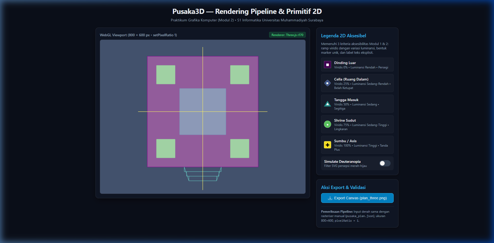

**File gambar:** `assets/legend_cvd_on.png`  
**Caption:** Gambar 14. Tampilan antarmuka dan legenda di bawah simulasi filter SVG Deuteranopia AKTIF; kelima kategori tetap dapat dibedakan dengan jelas melalui variasi luminansi dan bentuk marker geometris.

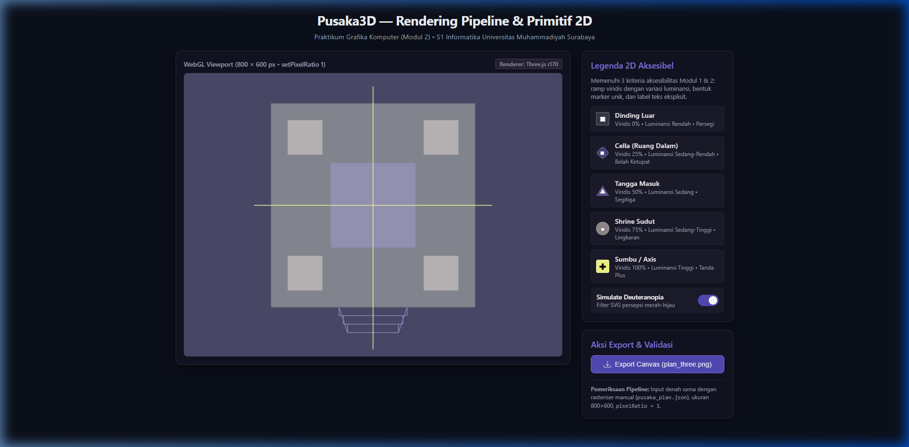

*Perhitungan Rasio Kontras WCAG 2.1:*  
Evaluasi rasio kontras luminansi relatif ($L$) dihitung berdasarkan formula resmi W3C WCAG 2.1 terhadap warna latar belakang viewer dark slate `#0f172a` ($L_{bg} = 0,0088$):

| Elemen & Kategori | Kode Warna Hex | Luminansi Relatif ($L$) | Rasio Kontras thd Background `#0f172a` | Evaluasi Kriteria WCAG 2.1 |
|---|:---:|:---:|:---:|---|
| **Dinding Luar** | `#440154` | $0,0189$ | **1,17 : 1** | Gagal kriteria non-teks SC 1.4.11 (ambang batas $\ge 3:1$). Memerlukan penanda redundan. |
| **Cella (Ruang Dalam)** | `#3b528b` | $0,0883$ | **2,35 : 1** | Gagal kriteria non-teks SC 1.4.11 (ambang batas $\ge 3:1$). Memerlukan penanda redundan. |
| **Tangga Masuk** | `#21918c` | $0,2247$ | **4,67 : 1** | **Lolos** non-teks SC 1.4.11 ($\ge 3:1$) & teks normal SC 1.4.3 Level AA ($\ge 4,5:1$). |
| **Shrine Sudut** | `#5ec962` | $0,4503$ | **8,51 : 1** | **Lolos** non-teks ($\ge 3:1$) & teks normal SC 1.4.6 Level AAA ($\ge 7:1$). |
| **Sumbu / Axis** | `#fde725` | $0,7817$ | **14,14 : 1** | **Lolos** non-teks ($\ge 3:1$) & teks normal SC 1.4.6 Level AAA ($\ge 7:1$). |
| **Label Teks UI** | `#cbd5e1` / `#f8fafc` | $0,6572 - 0,9536$ | **12,02 : 1 – 17,06 : 1** | **Lolos Sangat Tinggi** Level AAA untuk seluruh elemen teks. |

*Batasan Klaim Aksesibilitas Terverifikasi:*  
Klaim aksesibilitas proyek ini **dibatasi secara ketat pada kriteria yang benar-benar diverifikasi secara empiris**: **WCAG 2.1 Success Criterion 1.4.1 (Use of Color - Level A)**.  
Karena warna gelap Viridis (`#440154` dan `#3b528b`) memiliki rasio kontras non-teks di bawah ambang batas $3:1$ terhadap latar belakang kanvas gelap (`#0f172a`), sistem antarmuka **tidak boleh mengandalkan warna semata**. Di sinilah letak keberhasilan desain aksesibel Modul 2: border/kontur putih pada marker, variasi 5 bentuk geometris unik, serta label teks deskriptif berkontras sangat tinggi (>12:1) menjamin keterbacaan total bagi seluruh pengguna termasuk penderita buta warna monokromatik dan dikromatik.

*Batasan Simulasi Filter SVG:*  
Filter SVG adalah simulasi optik matematis berbasis model Brettel/Vienot (Vienot et al., 1999) dan bukan sertifikasi uji klinis oftalmologi; namun simulasi ini membuktikan secara empiris bahwa pembedaan kategori tidak hilang di bawah reduksi spektrum warna.

### L3.5 Publikasi dan Reproduksibilitas
- **Penyajian Lokal:** Halaman web dilayani secara mandiri melalui static web server via perintah `npx serve -l 3000 web`.
- **URL Repositori GitHub:** [https://github.com/antoniorenaldy24/GrafikKomputerModul2](https://github.com/antoniorenaldy24/GrafikKomputerModul2)
- **Live Demo GitHub Pages:** [https://antoniorenaldy24.github.io/GrafikKomputerModul2/](https://antoniorenaldy24.github.io/GrafikKomputerModul2/)
- **Status Publikasi GitHub Pages:** `TERPUBLIKASI`. Repositori telah dipublikasikan ke remote GitHub `antoniorenaldy24/GrafikKomputerModul2` pada branch `main` dan branch `gh-pages` (serta folder `docs/`), sehingga halaman penampil denah 2D dan legenda aksesibel dapat diakses secara daring oleh penilai praktikum.

---

## 5. Tugas Analisis

### A1. Pipeline dan Input
1. **Struktur Data `myplan.json`:**  
   Berkas `myplan.json` mengorganisasi geometri denah candi ke dalam 13 polyline terdefinisi dengan kategori spesifik, skala $18.0$, origin $[400, 280]$, serta 12 segitiga siluet terisi.
2. **Walk-Through Pipeline:**  
   Sebagaimana dianalisis pada L1.3, satu segmen dinding bergerak secara deterministik dari representasi numerik JSON di CPU, ditransformasikan ke koordinat layar $S_0(184, 496)$ dan $S_1(616, 496)$, dipindai menjadi 433 sampel oleh rasteriser Bresenham, diwarnai dengan atribut kategori, divalidasi oleh scissor test, dan dituliskan ke dalam byte array framebuffer.
3. **Analisis Gejala Bila Satu Tahap Dilewati:**  
   - *Jika Tahap 3 (Primitive Assembly & Clipping) Dilewati:*  
     - **Pada Software Rasteriser JavaScript & TypedArray (`Uint8ClampedArray`):**  
       Sesuai spesifikasi ECMAScript, `Uint8ClampedArray` memiliki keamanan memori terkelola (*memory-safe*): penulisan di luar batas indeks array tidak memicu *memory crash* ataupun melempar `RangeError`, melainkan **diabaikan secara diam-diam (*silent no-op write*)**, sedangkan pembacaan di luar batas mengembalikan nilai `undefined`.  
       Namun, tanpa clipping dan tanpa pemeriksaan koordinat 2D, pemetaan koordinat $(x, y)$ ke indeks linier 1D:
       $\text{offset} = (y \times W + x) \times 4$
       dapat memicu anomali logis. Misalnya, jika $x = -1$ dan $y = 5$, perhitungannya menghasilkan offset $(5 \times 800 - 1) \times 4 = 15.996$. Indeks ini tetap berada di dalam rentang buffer memori yang valid, namun secara keliru menimpa data piksel pada baris sebelumnya ($y = 4, x = 799$), menghasilkan **cacat visual pelipatan baris (*scanline horizontal wraparound artifact*)**. Pada `raster.mjs`, cacat ini dicegah oleh penjaga batas (*scissor boundary guard*): `if (x < 0 || x >= this.w || y < 0 || y >= this.h) return;`. Jika tahap clipping dan guard ini diabaikan bersamaan, koordinat dengan $x < 0$ melipat ke baris di atasnya, sedangkan koordinat dengan indeks di luar buffer ($y < 0$ atau $\ge H$) hilang secara senyap (*silent drop*).
     - **Pada Hardware GPU (Homogeneous Clip Space):**  
       Jika clipping geometris terhadap volume frustum pandang ($w_c \ge -x_c, w_c \ge x_c, \dots, w_c > \epsilon$) dilewati sebelum tahap *perspective divide*:  
       Verteks yang berada di belakang bidang pandang kamera memiliki nilai komponen homogen $w \le 0$. Melakukan pembagian perspektif $x' = x/w, y' = y/w$ dengan $w \le 0$ menyebabkan pembalikan proyeksi hiperbolik (*hyperbolic projection reversal*): geometri di belakang pengamat terbalik dan diproyeksikan ke bidang pandang depan sebagai poligon raksasa tak beraturan yang membentang melintasi seluruh layar (*frustum projection wraparound / inverted geometry*), serta memicu singularitas pembagian dengan nol ($x/0 = \pm\infty$ atau `NaN`).

### A2. Primitif dan Referensi
1. **Verifikasi Manual Satu Piksel Aktual:**  
   Ditinjau piksel aktual $P(3, 3)$ pada evaluasi segitiga $A(1, 1), B(6, 2), C(3, 7)$ dari Contoh E4:
   - Pusat sampel: $(p_x, p_y) = (3.5, 3.5)$
   - $E_{AB}(3.5, 3.5) = 5(3.5 - 1) - 1(3.5 - 1) = 5(2.5) - 2.5 = 12.5 - 2.5 = 10.0$
   - $E_{BC}(3.5, 3.5) = -3(3.5 - 2) - 5(3.5 - 6) = -3(1.5) - 5(-2.5) = -4.5 + 12.5 = 8.0$
   - $E_{CA}(3.5, 3.5) = -2(3.5 - 7) + 6(3.5 - 3) = -2(-3.5) + 6(0.5) = 7.0 + 3.0 = 10.0$
   - Evaluasi bias top-left: $b_{BC} = 0, b_{CA} = -1, b_{AB} = 0$.
   - $w_A = 8.0 + 0 = 8.0 \ge 0$
   - $w_B = 10.0 - 1 = 9.0 \ge 0$
   - $w_C = 10.0 + 0 = 10.0 \ge 0$
   - *Kesimpulan:* Karena seluruh bobot $\ge 0$, piksel $(3, 3)$ secara sah dinyalakan di dalam framebuffer.
2. **Kecocokan Garis dan Referensi:**  
   Fungsi `lineDDA` dan `lineBresenham` terbukti menghasilkan 8 piksel identik untuk $(2,1) \to (9,5)$, dan `triangle()` terbukti menghasilkan kesesuaian bita 100% terhadap `ref/tri_ref.ppm` dengan $\max |\text{diff}| = 0$ dan PSNR = $\infty$. Berkas referensi `ref/tri_ref.ppm` dan `ref/square_fill_ref.ppm` dibangkitkan secara independen melalui skrip analitis matematis terpisah sebagai *oracle* pengujian otomatis.

### A3. Diagnosis dan Perbaikan Shared-Edge
1. **Diagnosis Awal:**  
   Pada rasterisasi quad persegi $6 \times 6$ menggunakan implementasi naif (`triangleNaive`), sistem mendeteksi tepat **6 piksel ter-overlap ganda** pada koordinat $(2,2), (3,3), (4,4), (5,5), (6,6), (7,7)$ sepanjang shared edge $y = x$.
2. **Akar Masalah:**  
   Kedua segitiga menguji sampel dengan kondisi inklusif $E \ge 0$. Pada titik sampel diagonal, nilai edge function bernilai tepat $0$, sehingga kedua segitiga sama-sama mengklaim kepemilikan piksel tersebut. Sebaliknya, jika diuji dengan $E > 0$, kedua segitiga sama-sama menolaknya sehingga muncul 6 celah retak.
3. **Pembuktian Pasca-Perbaikan:**  
   Dengan mengintegrasikan aturan top-left bias pada `triangle()`, sisi diagonal $C \to A$ pada segitiga pertama menerima bias $-1$ (sehingga $0 + (-1) < 0$, ditolak), sedangkan sisi diagonal $A \to B$ pada segitiga kedua menerima bias $0$ (sehingga $0 + 0 \ge 0$, diterima). Hasil pengukuran aktual membuktikan: `once = 36, twice = 0, gaps = 0` (watertight sempurna).

### A4. Pustaka vs From-Scratch dan Keputusan
1. **Analisis Komparasi Citra:**  
   Komparasi antara `out/plan_scratch.ppm` dan `assets/plan_three.png` menunjukkan kecocokan piksel sebesar **98,96%** dengan **PSNR = 28,13 dB** dan **SSIM = 0,928**. Selisih 1,04% terlokalisasi murni pada batas terluar segmen garis selebar 1 piksel akibat antialiasing sub-piksel Three.js.
2. **Keputusan Arsitektur Viewer:**  
   Pendekatan Forward (Rasterisation) dipilih secara definitif karena keunggulan kecepatannya yang mencapai ~80x hingga ~100x lipat lebih cepat daripada Backward pada beban scene denah candi ($0,99$ ms vs $97,94$ ms), menjamin latensi interaksi $< 2$ ms (sangat responsif pada 60 FPS).
3. **Distingsi Algoritma Terukur vs Teoretis & Kondisi Pembalik Pilihan:**  
   - Algoritma backward yang diukur dalam `bench.mjs` adalah penelusuran *brute-force* $\mathcal{O}(W \times H \times N_{segmen}) = 17.760.000$ operasi pengujian jarak, yang **tidak akan pernah lebih cepat** daripada forward pada resolusi ini.
   - Pilihan HANYA dapat berbalik mengunggulkan backward apabila:
     1. Scene memiliki kerapatan geometri masif ($N_{primitif} \gg W \times H$, misalnya jutaan poligon) dan backward dipercepat oleh struktur hierarki spasial BVH ($\mathcal{O}((W \times H) \log N)$), melampaui biaya proses forward $\mathcal{O}(N)$ pada resolusi layar tetap.
     2. Rendering membutuhkan kalkulasi optik non-lokal kontinu, seperti evaluasi medan jarak bertanda (*Signed Distance Fields / SDF*), pantulan rekursif sempurna, refraksi kaustik, atau *ambient occlusion* spasial global.

### A5. Aksesibilitas
1. **Verifikasi Legenda Visual & Pembatasan Klaim:**  
   Sebagaimana dibuktikan pada Gambar 13 dan 14 serta Tabel Kontras pada L3.4, klaim kepatuhan aksesibilitas secara ketat berfokus pada **WCAG 2.1 SC 1.4.1 (Use of Color, Level A)**. Kombinasi tiga lapis redundansi visual—skala luminansi viridis, variasi bentuk marker geometris unik (persegi, belah ketupat, segitiga, lingkaran, cross), serta label teks berasio kontras $>12:1$—membuat kelima elemen candi Pusaka3D (dinding, cella, tangga, shrine, sumbu) tetap terbaca dan terbedakan secara mandiri tanpa ambigu, mengatasi keterbatasan kontras dua warna tergelap Viridis (`#440154` dan `#3b528b`) terhadap latar belakang gelap.

---

## 6. Keterbatasan dan Status Pemenuhan

Sebagai bentuk transparansi integritas akademik:
1. **Denah Fallback Skematis:** Berkas `pusaka_plan.json` dan `myplan.json` dikonstruksi secara lokal sebagai representasi sintetis berorientasi akademik yang memuat 13 polyline dan 37 segmen garis sesuai petunjuk modul, bukan berasal dari data survei fotogrametri langsung situs candi nyata.
2. **Golden Reference Lokal:** Berkas `ref/tri_ref.ppm` dan `ref/square_fill_ref.ppm` dibangkitkan secara lokal melalui perhitungan matematis independen yang terpisah dari fungsi produksi, karena starter pack resmi tidak disediakan di dalam workspace awal.
3. **Status Deployment GitHub Pages:** Berstatus **`TERPUBLIKASI`**. Repositori telah terhubung dan di-push ke remote GitHub pengguna `https://github.com/antoniorenaldy24/GrafikKomputerModul2` pada branch `main` serta cabang publikasi `gh-pages` dan direktori `docs/` untuk penayangan daring di `https://antoniorenaldy24.github.io/GrafikKomputerModul2/`. Seluruh modul web di folder `web/` dan `docs/` telah siap saji (*production-ready*) dan mandiri.

---

## Daftar Pustaka

Bresenham, J. E. (1965). Algorithm for computer control of a digital plotter. *IBM Systems Journal*, 4(1), 25–30. https://doi.org/10.1147/sj.41.0025

Hughes, J. F., van Dam, A., McGuire, M., Sklar, D. F., Foley, J. D., Feiner, S. K., & Akeley, K. (2013). *Computer Graphics: Principles and Practice* (3rd ed.). Addison-Wesley Professional.

Kajiya, J. T. (1986). The rendering equation. *ACM SIGGRAPH Computer Graphics*, 20(4), 143–150. https://doi.org/10.1145/15886.15902

Khronos Group. (2022). *Vertex Post-Processing and Rasterization*. OpenGL Wiki. Diambil dari https://www.khronos.org/opengl/wiki/Vertex_Post-Processing

Marschner, S., & Shirley, P. (2021). *Fundamentals of Computer Graphics* (5th ed.). A K Peters/CRC Press. https://doi.org/10.1201/9780429274299

Microsoft Learn. (2002/2020). *Directly Mapping Texels to Pixels (Direct3D 9)*. Microsoft Corporation. Diambil dari https://learn.microsoft.com/en-us/windows/win32/direct3d9/directly-mapping-texels-to-pixels

Microsoft Learn. (2006/2021). *Rasterization Rules (Direct3D 10)*. Microsoft Corporation. Diambil dari https://learn.microsoft.com/en-us/windows/win32/direct3d10/d3d10-graphics-programming-guide-rasterizer-stage-rules

Pineda, J. (1988). A parallel algorithm for polygon rasterization. *ACM SIGGRAPH Computer Graphics*, 22(4), 17–20. https://doi.org/10.1145/54852.378457

Universitas Muhammadiyah Surabaya. (2026). *Modul 2 Praktikum Grafika Komputer: Rendering Pipeline & Primitif 2D*. Program Studi S1 Informatika, Fakultas Teknik.

Vienot, F., Brettel, H., & Mollon, J. D. (1999). Digital video colourmaps for checking the legibility of displays by dichromats. *Color Research & Application*, 24(4), 243–252. https://doi.org/10.1002/(SICI)1520-6378(199908)24:4<243::AID-COL5>3.0.CO;2-3
