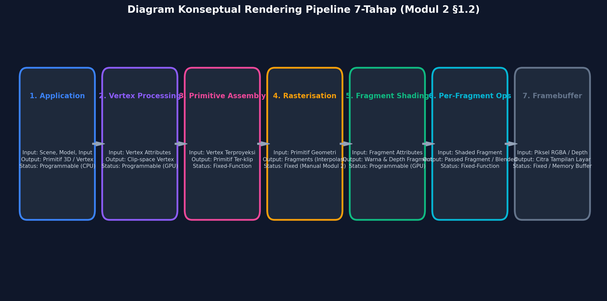

# SSOT — Modul 2: Rendering Pipeline & Primitif 2D

> **Status dokumen:** Instruksi utama (*Single Source of Truth*) untuk AI coding agent di Google Antigravity.  
> **Sumber akademik utama:** `Module2_ID (1).pdf`, Modul 2 Praktikum Grafika Komputer, S1 Informatika, Universitas Muhammadiyah Surabaya, terakhir diperbarui 21 September 2026.  
> **Bahasa keluaran:** Bahasa Indonesia yang jelas dan akademik. Istilah teknis boleh tetap dalam bahasa Inggris dan harus digunakan secara konsisten.  
> **Deliverable laporan:** satu file `Laporan_Modul_2.md`.  
> **Prioritas teknik:** implementasi sesederhana mungkin, tetapi jangan menghilangkan persyaratan eksplisit pada modul.

---

## 0. Instruksi utama untuk agent

Bertindaklah sebagai asisten praktikum Grafika Komputer yang teliti, implementer JavaScript minimal, penguji, dan penyusun laporan akademik. Selesaikan pekerjaan di workspace yang tersedia; jangan berhenti pada rencana atau contoh kode saja.

Sasaran akhir adalah satu paket tugas yang dapat ditinjau dan direproduksi, yang mencakup:

1. Tugas Studi Pendahuluan Q1–Q5.
2. Lab 1, Lab 2, dan Lab 3.
3. Tugas Analisis A1–A5.
4. Kode dan data minimum yang diperlukan.
5. Gambar bukti yang benar-benar dihasilkan, disimpan di `assets/`, disebutkan nama filenya dan caption-nya di bawah jawaban yang relevan dalam laporan.
6. Perintah untuk menjalankan tes dan mengulang hasil.
7. Halaman WebGL statis yang siap dipublikasikan, serta publikasi GitHub Pages bila akses dan repositori yang benar-benar tersedia memungkinkan.

**Jangan hanya membuat kerangka proyek.** Implementasikan, jalankan perintah pengujian yang relevan, periksa keluaran, perbaiki kegagalan yang ditemukan, lalu isi laporan dari bukti aktual.

### 0.1 Hierarki sumber kebenaran

Jika ada pertentangan, ikuti urutan berikut:

1. Persyaratan eksplisit dalam PDF modul yang tersedia di workspace.
2. Instruksi dalam SSOT ini, sepanjang tidak mengubah persyaratan modul.
3. Dokumentasi resmi dan referensi independen yang dapat diverifikasi, terutama untuk Q4 tentang Direct3D 9/10 dan half-pixel offset.
4. Keputusan implementasi minimal yang dicatat secara eksplisit di laporan bila materi tidak menyediakan data yang dibutuhkan.

Jangan mengganti istilah, angka, contoh, atau struktur penilaian modul secara diam-diam. Jika suatu detail tidak didukung oleh PDF, beri label sebagai hasil perhitungan, hasil eksperimen, asumsi implementasi, atau informasi referensi eksternal sesuai asalnya.

### 0.2 Larangan keras

- Jangan mengarang output tes, waktu benchmark, persentase pixel identik, PSNR, SSIM, screenshot, URL deployment, tanggal publikasi, atau sitasi.
- Jangan menulis “berhasil”, “sudah diuji”, “sudah dipublikasikan”, atau “semua tes lulus” sebelum hasil nyata mendukung klaim tersebut.
- Jangan membuat backend, database, sistem login, framework frontend, API, atau fitur lain yang tidak dibutuhkan modul.
- Jangan menambahkan dependency bila kemampuan Node.js bawaan atau dua dependency yang ditentukan modul sudah memadai.
- Jangan mengganti hasil uji aktual dengan angka contoh di PDF. Angka contoh hanya boleh disebut sebagai angka referensi dari modul.
- Jangan membuat denah sintetis lalu mengklaimnya sebagai denah bangunan asli, hasil survei, atau file starter resmi dosen.
- Jangan membuat gambar dekoratif yang seolah-olah merupakan bukti hasil program. Diagram penjelas boleh dibuat terpisah dan harus diberi label sebagai diagram konseptual.
- Jangan mengubah atau menghapus file pengguna yang sudah ada tanpa kebutuhan dan alasan yang jelas.
- Jangan menaruh token, credential, atau file rahasia di repository.

### 0.3 Prinsip pengerjaan

- **Minimal, bukan asal minimal:** pilih implementasi terkecil yang memenuhi butir penilaian.
- **Teori untuk tugas teori:** Studi Pendahuluan dikerjakan dalam laporan; jangan menulis program hanya untuk menjawab soal hitungan manual.
- **Bukti yang dapat diulang:** setiap tabel hasil dan klaim visual harus berasal dari file, skrip, atau pengujian yang tersedia.
- **Satu sumber data:** rasteriser manual dan viewer Three.js harus membaca geometri denah yang sama agar perbandingan bermakna.
- **Ekspektasi dipisahkan dari hasil:** prediksi performa ditulis dan disimpan sebelum benchmark dijalankan; hasil aktual ditambahkan sesudahnya.
- **Catat keterbatasan:** bila artefak starter atau akses publikasi tidak tersedia, ungkapkan secara jelas dan selesaikan sebanyak mungkin secara lokal.

---

## 1. Baca workspace sebelum memulai

Sebelum membuat file, periksa file di workspace aktif, termasuk folder proyek dan file yang sudah ada. Cari setidaknya:

- `Module2_ID (1).pdf` atau PDF Modul 2;
- `pusaka_plan.json` dan/atau `myplan.json`;
- `raster.mjs`, `plan.mjs`, `tests.mjs`, `draw_plan.mjs`, `draw_square.mjs`;
- folder `ref/`, `web/`, `out/`, dan `assets/`;
- `package.json`, `README.md`, konfigurasi Git, serta remote Git yang sudah terhubung.

Jangan menganggap file starter yang disebut dalam PDF pasti tersedia. User saat menulis SSOT hanya memiliki PDF dan belum memiliki starter project.

### 1.1 Penanganan denah fallback

1. Jika `pusaka_plan.json` tersedia di workspace atau sumber proyek yang telah diberikan, gunakan file itu terlebih dahulu dan jangan mengubah geometri sumber tanpa alasan.
2. Jika `pusaka_plan.json` tidak tersedia, jangan mengaku telah menggunakan file resmi dari dosen. Buat fallback lokal paling sederhana berdasarkan elemen yang secara eksplisit disebut PDF: dinding luar, cella/ruang dalam, tangga masuk, shrine di sudut, dan sumbu/axis. Simpan berkas tersebut dengan struktur yang jelas dan konsisten. Geometri dan skala yang tidak diberikan PDF harus dinyatakan sebagai **skematis/sintetis untuk demonstrasi**, bukan hasil survei atau ukuran bangunan nyata.
3. Beri catatan tersebut pada `README.md` serta bagian Lab 1 dan keterbatasan pada `Laporan_Modul_2.md`.
4. Bila fallback sintetis membuat persyaratan dosen tidak dapat diklaim terpenuhi sepenuhnya, tandai dengan jelas sebagai batasan, tetapi lanjutkan implementasi dan tes yang tetap bisa dibuktikan.
5. Gunakan struktur JSON konsisten dengan kebutuhan modul: polyline berlabel, satuan atau skala yang terdokumentasi, dan origin. Jelaskan skema sebenarnya yang dipakai dalam README. Jangan menulis metadata yang bertentangan dengan data geometri.

### 1.2 Referensi raster yang tidak tersedia

Jika file resmi `ref/tri_ref.ppm` atau aset referensi lain tidak ada:

- jangan mengaku file referensi lokal sebagai artefak resmi dosen;
- buat *golden reference* lokal melalui oracle/perhitungan independen yang terpisah dari fungsi produksi yang sedang diuji;
- jelaskan di README dan laporan bahwa file tersebut dibuat secara lokal karena starter project/referensi resmi tidak disertakan;
- tes perbandingan tetap harus membandingkan keluaran dengan referensi yang independen, bukan sekadar membandingkan sebuah fungsi dengan salinan outputnya sendiri.

---

## 2. Ruang lingkup implementasi dan struktur keluaran

Gunakan JavaScript biasa dan Node.js untuk rasteriser manual. Gunakan Three.js hanya untuk halaman visual Lab 3. Tidak perlu backend.

Struktur target yang disarankan (boleh disesuaikan bila ada struktur repo yang sudah berlaku, selama file dan perintah utamanya tetap mudah ditemukan):

```text
.
├── SSOT_Modul_2_Google_Antigravity.md
├── Laporan_Modul_2.md
├── README.md
├── package.json
├── raster.mjs
├── plan.mjs
├── draw_plan.mjs
├── draw_square.mjs
├── triangle_gap_bug.mjs
├── bench.mjs
├── metrics.mjs
├── compare.mjs
├── tests.mjs
├── pusaka_plan.json              # gunakan dari starter jika tersedia; jika tidak, fallback lokal yang diberi label
├── myplan.json                   # input Lab 1, bila diperlukan oleh struktur yang dipilih
├── ref/
│   └── tri_ref.ppm               # referensi resmi jika tersedia, selain itu golden reference lokal yang dijelaskan
├── out/                          # keluaran program yang bisa diregenerasi
├── assets/                       # gambar bukti yang dipakai laporan
└── web/
    ├── index.html
    ├── viewer.mjs
    └── cvd.css
```

`out/` berisi artefak yang bisa dibuat ulang dan tidak harus semuanya dimasukkan ke laporan. `assets/` berisi gambar yang ditautkan di laporan. Hindari duplikasi yang tidak perlu; jika sebuah gambar dari `out/` dijadikan bukti laporan, salin/ekspor ke `assets/` dengan nama deskriptif yang stabil.

### 2.1 Dependency dan lingkungan

- Core rasteriser, data denah, benchmark, serta tes tidak boleh membutuhkan framework.
- Untuk sisi web, ikuti modul: install hanya dependency `three` dan `serve` kecuali ada kebutuhan teknis yang benar-benar tak terhindarkan. Jika menambah dependency, jelaskan alasan di README dan laporan; pilihan pertama tetap tidak menambahnya.
- Cantumkan OS, versi Node.js, browser dan versi, versi Three.js, serta tanggal pengujian aktual dalam laporan dan README.
- Jangan mengarang versi. Ambil dari environment atau perintah versi yang nyata.
- Gunakan ukuran render tetap yang terdokumentasi. Untuk raster denah manual, gunakan `800 × 600` sebagai ukuran awal sesuai contoh perintah modul kecuali struktur starter yang ditemukan mensyaratkan parameter berbeda.
- Pada Three.js tetapkan ukuran canvas secara eksplisit dan `renderer.setPixelRatio(1)` sebelum export agar dua gambar memakai grid pixel yang sebanding.

---

## 3. Tugas Studi Pendahuluan — minimum empat halaman

Bagian ini merupakan laporan tertulis sebelum praktikum. Jawab semua subpertanyaan Q1–Q5. Sediakan kedalaman isi yang secara wajar setara **minimal empat halaman** saat diformat satu kolom dengan spasi 1,5; jangan menambah pengulangan hanya untuk memenuhi panjang. Sertakan diagram yang memang membantu, contoh angka kecil buatan sendiri, serta sitasi.

### Q1. Pipeline dan light transport

#### Q1(a) Pipeline tujuh tahap

Buat diagram yang menunjukkan urutan tujuh tahap dari §1.2 modul:

1. Application.
2. Vertex processing.
3. Primitive assembly & clipping.
4. Rasterisation (scan conversion).
5. Fragment shading.
6. Per-fragment operations.
7. Framebuffer.

Untuk **setiap** tahap, tulis satu baris atau lebih yang menjelaskan input, output, dan status programmable/fixed sesuai framing modul. Jelaskan bahwa klasifikasi programmable/fixed mengikuti materi praktikum; bila perlu, beri catatan bahwa detail API/hardware modern dapat bervariasi tanpa mengubah urutan konseptual yang sedang dipelajari.

Buat diagram sebagai gambar lokal dan gunakan nama `assets/pipeline_7_tahap.png`. Gambar harus terbaca dan sama dengan penjelasan teks.

#### Q1(b) Light transport

Definisikan light transport dalam satu kalimat sesuai modul: cahaya meninggalkan sumber, berinteraksi/terpencar pada permukaan, lalu sebagian mencapai mata atau kamera. Terangkan hubungan fisik yang didekati renderer dengan perbedaan arah perhitungan rasterisation dan ray tracing. Jangan menyatakan bahwa kedua algoritma selalu menghasilkan output identik dalam semua kondisi; batasi klaim pada primary visibility/scene dan asumsi yang dibahas modul.

#### Q1(c) Forward vs backward

- **Forward/object-order/rasterisation:** loop atas primitif dan menulis/menyentuh pixel yang tertutupinya.
- **Backward/image-order/ray casting:** loop atas pixel, lalu menguji ray terhadap objek/scene.

Berikan satu contoh yang sesuai petunjuk modul untuk masing-masing: banyak segitiga kecil pada renderer real-time untuk rasterisation, dan scene/permukaan reflektif yang lebih cocok dianalisis dengan ray tracing untuk ray casting. Jelaskan alasan kompleksitas dan efek yang relatif ekonomis pada tiap pendekatan. Jangan memberi angka percepatan tanpa pengukuran.

### Q2. Garis

#### Q2(a) DDA manual

Kerjakan untuk segmen `(2, 1) → (9, 5)`:

- hitung `Δx`, `Δy`, `step = max(|Δx|, |Δy|)`;
- hitung increment per langkah;
- tunjukkan nilai eksak/pecahan dan pembulatan yang relevan;
- daftar kedelapan pixel secara berurutan.

Hasil yang diharapkan menurut contoh modul:

`(2,1), (3,2), (4,2), (5,3), (6,3), (7,4), (8,4), (9,5)`.

#### Q2(b) Bresenham manual

Untuk segmen yang sama, tunjukkan variabel keputusan `D = 2Δy − Δx`, nilai awal, aturan update, dan nilai/pilihan pixel per kolom x. Periksa bahwa daftar pixel cocok dengan hasil (a). Jelaskan konvensi update yang dipakai, termasuk apakah kondisi `D > 0` mengikuti listing contoh modul.

#### Q2(c) Integer-only

Terangkan mengapa Bresenham memanfaatkan penjumlahan, pengurangan, dan perbandingan integer; hubungkan dengan keterbatasan komputasi tahun 1962 sebagaimana dijelaskan modul dan relevansinya sebagai algoritma/ide rasterisasi. Jangan mengklaim setiap GPU modern mengeksekusi algoritma software Bresenham yang sama persis; bedakan algoritma garis diskret dari rasteriser hardware.

### Q3. Segitiga

#### Q3(a) Edge function

Gunakan definisi:

`E_AB(P) = (B_x − A_x)(P_y − A_y) − (B_y − A_y)(P_x − A_x)`.

Jelaskan makna tanda positif/nol/negatif terhadap sisi berarah `A → B` dan hubungkan besar absolutnya dengan dua kali luas segitiga `ABP`.

#### Q3(b) Hitungan segitiga

Gunakan koordinat dari modul:

- `A = (1,1)`, `B = (6,2)`, `C = (3,7)`;
- `P1 = (3,3)`, `P2 = (5,5)`, `P3 = (1,4)`.

Hitung `E_AB(C)`, luas, winding menurut konvensi koordinat matematika pada soal, semua tiga edge function untuk setiap titik uji, dan putusan di dalam/di luar. Hasil referensi modul yang harus direproduksi dalam penjelasan:

- `E_AB(C) = 28`, sehingga luas geometris segitiga = `14` satuan luas;
- `P1`: `(E_AB, E_BC, E_CA) = (8, 12, 8)`, di dalam;
- `P2`: `(16, −4, 16)`, di luar;
- `P3`: `(15, 19, −6)`, di luar;
- barycentric `P1`: `(λ_A, λ_B, λ_C) = (3/7, 2/7, 2/7)`.

Buat diagram segitiga dengan label A/B/C dan P1/P2/P3 yang konsisten dengan angka tersebut, simpan sebagai `assets/edge_function_triangle.png`.

#### Q3(c) Barycentric

Definisikan `(λ_A, λ_B, λ_C)`, tuliskan relasinya dengan edge functions dan total luas bertanda dengan indeks vertex yang benar. Jelaskan `λ_A + λ_B + λ_C = 1` dan fungsi bobot untuk interpolasi warna/depth/texture. Gunakan contoh interpolasi nilai dari modul: bobot `(0.5, 0.25, 0.25)` untuk nilai vertex `(10, 20, 40)` menghasilkan `20`.

#### Q3(d) Top-left rule

Terangkan mengapa `E ≥ 0` pada kedua segitiga dapat menggambar bersama-edge dua kali, sedangkan `E > 0` dapat meninggalkan celah. Tuliskan prinsip top-left dalam konvensi yang dipakai modul: sebuah sampel tepat pada edge diterima hanya oleh pemilik edge top/left. Jelaskan bias `0` untuk edge top/left dan `−1` untuk edge lain di bawah konvensi integer/bias modul. Tegaskan bahwa definisi top/left bergantung pada konvensi sumbu dan winding yang dinyatakan.

### Q4. Sample-centre dan insiden half-pixel

Jawab Q4(a)–Q4(d), menggunakan halaman Microsoft Direct3D 9 **“Directly Mapping Texels to Pixels”** dan minimal satu sumber independen sebagaimana diminta modul (misalnya OpenGL Wiki atau sumber teknis independen yang kredibel).

- Q4(a): jelaskan konvensi koordinat pixel Direct3D 9, letak pusat pixel/koordinat integer, dan offset blit yang relevan menurut sumber.
- Q4(b): uraikan gejala citra saat offset salah/tidak ada, serta kaitannya dengan bilinear sampling di antara empat texel.
- Q4(c): jelaskan konvensi modern yang diperkenalkan Direct3D 10 sebagaimana materi rujukan dan mengapa hal itu menghilangkan jebakan tertentu.
- Q4(d): sebutkan perkiraan tanggal/era yang ditopang sumber dan sitasikan sumbernya.

**Verifikasi sumber diwajibkan.** Buka sumber asli yang tersedia, verifikasi klaim, tanggal, dan URL; jangan hanya mengulang klaim tanpa sumber. Jangan menciptakan tanggal publikasi, tanggal akses, atau kutipan. Jika tanggal pasti tidak tersedia, nyatakan bahwa tanggalnya tidak tercantum dan gunakan hanya rentang era yang benar-benar didukung. Untuk APA 7, tulis metadata sumber berdasarkan halaman nyata.

Dalam bagian refleksi Lab 1, kaitkan konsep tersebut dengan sampling pada `(x + 0.5, y + 0.5)`, citra checkerboard/grid satu-pixel, dan satu tes regresi yang dapat mendeteksi pergeseran.

### Q5. Menggambar dengan pustaka

#### Q5(a)

Jelaskan perbedaan serta penggunaan Three.js `Line`, `Shape`/`ShapeGeometry`, dan `Mesh`. Nyatakan pilihan untuk:

- outline polyline denah;
- siluet yang terisi;
- swatch/marker legenda.

#### Q5(b)

Nyatakan tiga syarat konkret legenda aksesibel yang mengacu pada prinsip CVD Modul 1 dan jelaskan implementasinya. Persyaratan Lab 3 yang dinyatakan eksplisit di Modul 2 adalah:

- ramp warna viridis dengan variasi luminansi;
- label teks;
- bentuk marker berbeda per kategori;
- toggle simulasi deuteranopia dengan filter SVG;
- verifikasi visual dengan toggle aktif dan nonaktif.

Jangan mengklaim simulasi filter SVG sebagai penilaian klinis atau jaminan aksesibilitas penuh. Sebutkan cakupan/keterbatasannya.

### Syarat umum Studi Pendahuluan

- Rujuk bab/bagian spesifik buku sesuai petunjuk modul: Marschner & Shirley, *Fundamentals of Computer Graphics*, edisi ke-5, Bab 3 dan Bab 8–9; serta Hughes & van Dam et al., *Computer Graphics: Principles and Practice*, edisi ke-3, Bab 3 dan Bab 18.
- Verifikasi detail bibliografis untuk daftar pustaka APA 7 dari sumber yang benar; jangan mengarang tahun, publisher, DOI, atau nomor halaman.
- Berikan diagram atau contoh kecil yang benar-benar membantu, bukan ilustrasi dekoratif.
- Sertakan nama file dan caption setiap gambar di bawah jawaban terkait.

---

## 4. Lab 1 — Denah, pipeline, pembacaan referensi, refleksi insiden

Ikuti enam butir Lab 1 dalam modul.

### Lab 1.1 — Catat toolchain

Tuliskan OS, versi Node.js, browser dan versi, versi Three.js, serta tanggal pengujian berdasarkan environment sebenarnya. Simpan juga di README. Jika nilai tidak dapat dibaca, tandai belum diverifikasi alih-alih menebak.

### Lab 1.2 — Input denah

Sediakan file JSON denah yang dipakai bersama oleh rasteriser dan viewer. Denah minimal mencakup dinding luar, satu pembagian interior, dan pintu masuk. Gunakan fallback sesuai §1.1 bila file resmi tidak ada. Geometri, satuan, scale, origin, label, dan transformasi harus konsisten di seluruh kode.

Dalam laporan, nyatakan apakah geometri berasal dari file sumber resmi, denah yang ditelusuri dari sumber nyata, atau fallback skematis lokal. Jangan menyebut denah sintetis sebagai survei aktual.

### Lab 1.3 — Pipeline satu segmen dinding

Tuliskan satu baris penjelasan untuk masing-masing dari tujuh tahap pipeline: bagaimana satu segmen dinding bergerak dari JSON ke pixel yang terlihat. Penjelasan perlu mengikuti implementasi aktual dan istilah §1.2.

### Lab 1.4 — Prediksi forward vs backward di atas kertas

Untuk zoom `10×`, tulis prediksi sebelum menjalankan benchmark:

- pendekatan forward: rasterisasi polyline/segmen dan tulis pixel yang disentuh;
- pendekatan backward: untuk setiap pixel layar, uji jarak terhadap setiap segmen sesuai definisi implementasi.

Berikan alasan kompleksitas dan perkiraan kualitatif atau rasio yang disebut secara eksplisit sebagai **prediksi**, bukan hasil tes. Simpan sebelum benchmark. Jangan menulis angka pengukuran terlebih dahulu lalu mengaku angka itu prediksi awal.

### Lab 1.5 — Baca salah satu referensi

Baca satu dari referensi yang diizinkan modul: halaman OpenGL Wiki terkait vertex post-processing/rasterization, artikel fundamental rasterization WebGL, atau source contoh `Line` Three.js. Tulis refleksi sekitar setengah halaman mengenai satu perbedaan spesifik dari rasteriser lokal dan alasannya. Cantumkan URL/judul dan sumber yang benar-benar dibaca.

### Lab 1.6 — Refleksi kasus half-pixel

Tuliskan sekitar setengah halaman yang mencakup:

1. offset dan letak pusat pixel menurut sumber untuk D3D9 dibandingkan konvensi D3D10 yang dibahas;
2. baris kode persis pada implementasi rasteriser yang mengodekan sample-centre, misalnya `x + 0.5` dan `y + 0.5` jika memang itulah kode aktual;
3. citra uji yang dapat membuat bug jelas, seperti checkerboard atau grid satu pixel;
4. perubahan/tes regresi yang akan menangkap bug;
5. tanggal dan sumber yang bisa diverifikasi.

---

## 5. Lab 2 — Implementasi dari nol, diagnosis celah, perbaikan

Tujuan Lab 2 adalah implementasi primitif manual dalam JavaScript tanpa framework, pengujian yang sesuai contoh, diagnosis shared-edge, serta minimal satu perbaikan dari daftar pitfall.

### Lab 2.1 — Implementasi dari nol

Implementasikan dan dokumentasikan:

1. `lineDDA(A, B)`.
2. `lineBresenham(A, B)` dengan dukungan kedelapan oktan.
3. `triangle(fb, A, B, C, rgb)` menggunakan edge functions, sample-centre, konvensi winding terdokumentasi, dan aturan top-left.
4. `barycentric(A, B, C, P)` yang mengembalikan `(λA, λB, λC)`.
5. frame buffer sederhana dan penulisan output raster yang dapat diverifikasi.

Jangan menarik implementasi dari pustaka grafika untuk menggantikan algoritma yang diwajibkan dibuat sendiri.

### Lab 2.2 — Tes wajib

#### Garis DDA/Bresenham

- Untuk `(2,1) → (9,5)`, kedua algoritma harus menghasilkan daftar 8-pixel yang telah tercantum di Q2.
- Tes kedelapan oktan dengan merefleksikan segmen dan memeriksa urutan, titik akhir, dan sifat yang relevan.
- Buat asterisk 24-jari-jari dari pusat, dengan garis setiap `15°`; pastikan setiap jari-jari memiliki panjang pixel yang sama dalam toleransi `±1` sebagaimana instruksi modul. Dokumentasikan metode pembulatan endpoint dan batasan diskretisasinya.

#### Segitiga/edge function/barycentric

- Reproduksi nilai edge function pada Q3(b) untuk tiga titik uji.
- Verifikasi jumlah bobot barycentric mendekati `1` dengan toleransi floating point yang masuk akal; untuk kasus integer contoh modul, jelaskan hasil pecahannya.
- Cocokkan raster segitiga dengan `ref/tri_ref.ppm` dan laporkan `max |diff|`. Target dari instruksi tugas adalah `0` untuk fixture referensi yang sama. Bila referensi course-provided tidak tersedia dan dipakai golden reference lokal, beri keterangan itu.
- Gunakan satu konvensi koordinat dan winding yang eksplisit di seluruh modul. Jangan mencampur y-up dan y-down secara diam-diam.

**Pemeriksaan presisi untuk bias top-left:** listing modul menggunakan pusat sampel `(x + 0.5, y + 0.5)` dan bias edge `0`/`−1`. Pastikan kombinasi implementasi benar-benar hanya menolak sampel yang tepat berada pada edge non-top/left, bukan sampel interior yang nilainya positif tetapi lebih kecil daripada bias. Jika diperlukan, gunakan perbandingan eksplisit `E > 0` atau `E == 0` plus kepemilikan edge, atau koordinat fixed-point yang diskalakan secara konsisten sehingga bias integer hanya mengatasi tie yang tepat. Pertahankan definisi matematis edge function pada soal, dokumentasikan skala/konvensi kode yang digunakan, dan validasikan kembali semua hasil coverage yang diwajibkan modul. Jangan mengubah hasil tes secara manual untuk menyembunyikan masalah presisi.

#### Top-left/shared edge

Gunakan kotak contoh modul dengan koordinat sudut `(2,2)` dan `(8,8)`, dibagi menjadi dua segitiga sepanjang diagonal. Dengan aturan top-left, 36 pixel interior pada area `6 × 6` masing-masing harus diklaim tepat sekali:

- `once = 36`;
- `twice = 0`;
- `gaps = 0`.

Jalankan juga varian bermasalah untuk membuktikan diagnosis. Acuan demonstrasi di modul: tanpa top-left, ada 6 pixel pada shared edge yang diklaim dua kali; dengan syarat ketat `> 0`, 6 pixel shared-edge bisa tidak diklaim. Hasil lokal harus berasal dari program nyata dan sesuai geometri/aturan yang benar-benar dipakai.

Buat gambar coverage yang membedakan pixel yang hanya terisi sekali, tergambar ganda, dan kosong. Simpan di `assets/shared_edge_coverage.png`.

#### Sample-centre

Uji rectangle `2 × 2` pada `(1,1)` di framebuffer hitam `6 × 6`:

- versi benar memakai pusat sampel `(x + 0.5, y + 0.5)`;
- versi pembanding sengaja memakai konvensi sudut pixel yang salah;
- simpan visualisasi hasil aktual keduanya dan jelaskan perbedaan jumlah cakupan.

Buat `assets/sample_centre_2x2_vs_corner_3x3.png`. Jangan menggunakan gambar ilustratif sebagai pengganti output uji aktual.

### Lab 2.3 — Terapkan minimal satu perbaikan pitfall

Pilih perbaikan paling sederhana yang benar-benar bisa didemonstrasikan dari opsi modul. Prioritas yang disarankan: **auto-flip winding** untuk segitiga terbalik, karena implementasi dan pengujiannya relatif sederhana. Pastikan tes membuktikan bahwa bentuk tetap terisi setelah vertex disusun ulang sesuai konvensi.

Alternatif lain sesuai modul:

- clamp bounding box dan ukur efeknya terhadap segitiga kecil pada framebuffer besar; atau
- tambahkan antialiasing gaya Wu dan demonstrasikan linear-light blending dibandingkan blending naif.

Jangan mengimplementasikan seluruh extension opsional. Cukup satu perbaikan wajib plus bukti tes dan penjelasan.

### Lab 2.4 — Diagnosis sebelum perbaikan

Urutan kerja harus memperlihatkan diagnosis dahulu: jalankan/teliti versi tanpa top-left, catat pixel duplikat/hilang dan penyebab yang diduga, baru ubah implementasi. Simpan perbedaan sebelum/sesudah jika dapat dihasilkan dengan jelas.

### Lab 2.5 — Artefak Lab 2

Simpan paling tidak bukti visual untuk:

- daftar/plot pixel DDA dan Bresenham;
- segitiga dan klasifikasi titik/coverage edge function;
- shared edge sebelum dan sesudah perbaikan;
- sample-centre versus corner sampling;
- asterisk 24 arah;
- satu pitfall yang dipilih dan dampak perbaikannya.

Nama file harus stabil, deskriptif, dan terhubung ke jawaban yang relevan di `Laporan_Modul_2.md`.

---

## 6. Lab 3 — Three.js, perbandingan, benchmark, aksesibilitas, publikasi

Buat viewer statis sekecil mungkin. Tidak memerlukan backend. Halaman harus membaca denah yang sama dengan rasteriser manual.

### Lab 3.1 — Render memakai Three.js

- Render outline polyline sebagai `THREE.Line` atau representasi line sesuai kebutuhan geometrinya.
- Render siluet terisi menggunakan `THREE.Shape`/`THREE.ShapeGeometry` dan `Mesh` bila sesuai.
- Tetapkan ukuran canvas eksplisit dan `setPixelRatio(1)` sebelum export.
- Sediakan cara yang benar-benar berfungsi untuk mengekspor canvas sebagai `plan_three.png`.
- Jangan mengklaim ekspor berhasil sebelum file gambar valid ada dan bisa dibuka.

### Lab 3.2 — Bandingkan dengan rasteriser manual

Bandingkan hasil rasteriser manual dan hasil Three.js pada ukuran pixel yang sebanding. Hasil minimal:

- persentase pixel identik;
- PSNR;
- citra selisih (*difference image*);
- penjelasan pixel yang berbeda.

Modul menyatakan bahwa perbedaan yang diharapkan terutama berasal dari antialiasing edge pustaka dibandingkan edge integer yang keras. **Verifikasi ini dari citra selisih.** Jika ditemukan offset geometri, ukuran canvas berbeda, sumbu terbalik, atau error lain, perbaiki terlebih dahulu; jangan langsung menamainya antialiasing.

Pastikan decoder PNG/PPM yang dipakai betul-betul membaca data gambar yang sesuai. Bila menggunakan ukuran/citra yang berbeda, hentikan perbandingan dan perbaiki normalisasi ukuran terlebih dahulu.

Simpan citra perbandingan dan diff dalam `assets/`, beserta nama dan caption di bawah butir jawaban terkait.

### Lab 3.3 — Prediksi dan benchmark forward/backward

Urutan penting:

1. Tulis prediksi untuk zoom `1×` dan `10×` sebelum benchmark dijalankan, sesuai Lab 1.
2. Implementasikan kedua metode dengan definisi dan ukuran output yang jelas.
3. Warm-up jika relevan, jalankan beberapa pengulangan, dan laporkan statistik yang konsisten (misalnya median). Cantumkan jumlah pengulangan, dimensi framebuffer, jumlah segmen, kondisi lingkungan, dan satuan ms.
4. Catat hasil aktual `ms` untuk forward dan backward pada kedua zoom.
5. Rekonsiliasikan prediksi dengan hasil aktual; pilih metode yang masuk akal untuk viewer pan/zoom beserta alasannya.
6. Nyatakan kondisi yang dapat membalik pilihan. Tugas Analisis meminta minimal dua contoh konkret, misalnya jumlah segmen, rentang zoom, efek per-pixel, atau target CPU/GPU.

Jangan mengarang atau menyalin angka benchmark contoh. Jangan menyebut satu pendekatan “selalu lebih cepat”.

### Lab 3.4 — Legenda aksesibel

Sediakan lima kategori yang disebut modul:

1. dinding;
2. cella;
3. tangga;
4. shrine;
5. sumbu/axis.

Legenda harus menggunakan:

- ramp viridis dengan luminansi bervariasi;
- label teks eksplisit;
- bentuk marker berbeda untuk kategori-kategori;
- toggle **Simulate deuteranopia** dengan filter SVG;
- gambar bukti kondisi filter mati dan menyala.

Periksa apakah kelima kategori tetap dapat dibedakan saat filter dinyalakan. Gunakan kombinasi warna, luminansi, bentuk, dan label; jangan menjadikan warna satu-satunya pembeda. Nyatakan bahwa filter adalah simulasi visual dan bukan sertifikasi aksesibilitas penuh.

Simpan bukti yang relevan di `assets/`, misalnya `legend_cvd_off.png` dan `legend_cvd_on.png`.

### Lab 3.5 — Ship/serve/expose

- Pastikan `web/index.html` berfungsi saat dilayani secara lokal melalui static server.
- Pastikan petunjuk menjalankan halaman tersedia di README.
- Siapkan halaman untuk GitHub Pages dan publikasikan bila repo/remote dan autentikasi yang tepat tersedia.
- Periksa status publikasi dari URL sebenarnya, bila dilakukan.
- **Jika workspace tidak memiliki remote Git, akses GitHub, izin, atau informasi repo yang dibutuhkan, jangan menebak repo atau mengarang URL.** Lengkapi halaman lokal dan konfigurasi yang dapat disiapkan, lalu tandai deployment sebagai `BELUM DIPUBLIKASIKAN` beserta tindakan spesifik yang dibutuhkan. Jangan klaim seluruh Lab 3 selesai sebelum URL bisa diakses dan diverifikasi.

### Lab 3.6 — Reproduksi dari clean clone

Ikuti semangat instruksi modul:

- clone baru atau simulasi bersih tanpa mengandalkan file cache;
- instal dependency yang diperlukan saja;
- jalankan `npm test` hingga lulus;
- jalankan static server untuk folder `web/`;
- tangani manual step yang memang diperlukan dan dokumentasikan;
- tambahkan baris `Verified` pada README hanya setelah perintah nyata berhasil dijalankan dari kondisi yang bersih.

---

## 7. Tugas Analisis A1–A5

Satu file laporan harus memuat semua subbagian berikut. Tugas Analisis adalah analisis terhadap pekerjaan Lab 1–3; jangan menulisnya seolah-olah hasil lab telah dilakukan bila buktinya belum ada.

### A1. Dari Lab 1 — pipeline dan input

- Sajikan atau tunjukkan `myplan.json` yang benar-benar dipakai.
- Jelaskan perjalanan satu segmen dinding melewati setiap tahap pipeline §1.2.
- Untuk satu tahap pipeline, jelaskan gejala konkret jika tahap itu dilewati pada render denah.
- Cantumkan gambar yang mendukung penjelasan bila relevan.

### A2. Dari Lab 2 — primitif dan referensi

- Pilih satu pixel aktual yang dinyalakan `triangle()` di dekat edge.
- Hitung tiga edge function dan bias top-left secara manual.
- Jelaskan hasilnya: inside, on-edge yang diterima oleh pemilik edge, atau outside.
- Sajikan bukti daftar 8-pixel DDA/Bresenham untuk `(2,1) → (9,5)`.
- Sajikan hasil perbandingan terhadap `ref/tri_ref.ppm` dan `max |diff|`; jika golden reference lokal digunakan, labeli sumbernya dengan jujur.

### A3. Dari Lab 2 — diagnosis dan perbaikan

- Tuliskan diagnosis awal sebelum perbaikan.
- Cantumkan jumlah pixel yang tergambar ganda atau hilang dari keluaran aktual.
- Jelaskan bahwa akar masalah adalah penanganan shared edge/top-left yang tidak tepat.
- Sertakan bukti coverage sesudah perbaikan dengan `0 double` dan `0 gaps` untuk contoh modul.
- Nyatakan edge mana yang mendapat bias `0` dan mana yang mendapat `−1` sesuai konvensi yang benar-benar dipakai.

### A4. Dari Lab 3 — pustaka vs from-scratch dan keputusan

- Sajikan tabel hasil perbandingan: persentase pixel identik dan PSNR.
- Sertakan citra diff dan jelaskan setiap jenis ketidakcocokan yang ditemukan.
- Sajikan prediksi sebelum benchmark, hasil ms aktual pada zoom `1×` dan `10×`, rekonsiliasi, dan pilihan yang di-commit untuk viewer.
- Sajikan minimal dua kondisi konkret ketika pilihan forward/backward dapat berbalik.

### A5. Dari Lab 1/3 — aksesibilitas

- Tampilkan atau tautkan gambar legenda dengan toggle deuteranopia mati dan menyala.
- Nyatakan penerapan ramp luminansi viridis, bentuk berbeda, dan label teks.
- Verifikasi bahwa lima kategori yang diwajibkan tetap dapat dibedakan dalam kedua kondisi. Jangan hanya mengklaimnya tanpa memeriksa bukti visual.

---

## 8. Standar gambar, nama file, dan caption

Semua gambar bukti yang dipakai di laporan harus berupa file yang benar-benar ada, dapat dibuka, dan berasal dari salah satu sumber berikut:

- output kode/tes/benchmark aktual;
- screenshot halaman yang berjalan;
- diagram teknis yang dibuat untuk menjelaskan konsep, dengan label **diagram konseptual** bila bukan output program.

Simpan di `assets/` dan gunakan path relatif. Hindari spasi pada nama file. Gunakan format PNG untuk diagram/screenshot laporan kecuali format lain memang menjadi keluaran yang diwajibkan, seperti PPM reference raster.

### 8.1 Format wajib di bawah jawaban relevan

Tepat di bawah jawaban/subbagian yang didukung bukti, gunakan pola ini:

```markdown
**File gambar:** `assets/pipeline_7_tahap.png`  
**Caption:** Gambar 1. Diagram konseptual tujuh tahap rendering pipeline sesuai urutan pada Modul 2.


```

Sesuaikan nama, nomor, dan caption dengan file serta isi aktual. Nomor gambar harus berurutan atau menggunakan nomor unik yang konsisten. Jangan gunakan caption yang menyatakan klaim lebih jauh dari apa yang ditampilkan.

User meminta **nama file dan caption setelah nama file**. Karena itu, jangan hanya menaruh gambar tanpa metadata teks; tampilkan baris `File gambar` diikuti `Caption`, lalu embed gambar Markdown tepat di bawahnya agar gambar ikut tampil ketika laporan dibuka.

### 8.2 Daftar kandidat gambar yang diharapkan

Buat gambar jika gambar itu benar-benar membantu jawaban atau menjadi bukti yang diwajibkan. Jangan membuat gambar duplikat hanya untuk memenuhi daftar.

| Nama file yang disarankan | Penggunaan utama | Tipe bukti |
|---|---|---|
| `assets/pipeline_7_tahap.png` | Studi Pendahuluan Q1(a), Lab 1, A1 | Diagram konseptual |
| `assets/line_dda_bresenham.png` | Q2 bila dibutuhkan, Lab 2, A2 | Hasil pixel aktual/visualisasi angka |
| `assets/edge_function_triangle.png` | Q3, Lab 2, A2 | Diagram berlabel dan konsisten dengan hitungan |
| `assets/shared_edge_before.png` | Lab 2, A3 | Keluaran bug aktual sebelum perbaikan |
| `assets/shared_edge_coverage.png` | Lab 2, A3 | Coverage aktual sesudah perbaikan |
| `assets/sample_centre_2x2_vs_corner_3x3.png` | Lab 2 | Keluaran aktual kedua konvensi sampling |
| `assets/asterisk_24_rays.png` | Lab 2 | Keluaran aktual tes delapan oktan/24 arah |
| `assets/winding_fix.png` | Lab 2 perbaikan pitfall | Bukti aktual winding normal dan terbalik |
| `assets/plan_scratch.png` | Lab 1/Lab 3 | Hasil rasteriser manual |
| `assets/plan_three.png` | Lab 3/A4 | Hasil export Three.js aktual |
| `assets/plan_difference.png` | Lab 3/A4 | Citra diff dari proses compare |
| `assets/legend_cvd_off.png` | Lab 3/A5 | Screenshot halaman dengan filter mati |
| `assets/legend_cvd_on.png` | Lab 3/A5 | Screenshot halaman dengan filter menyala |
| `assets/forward_backward_benchmark.png` | Lab 3/A4, jika grafik membantu | Visualisasi benchmark dari data aktual |

Jika jawaban tertentu lebih baik dijelaskan dengan tabel/perhitungan daripada gambar, jangan memaksakan gambar. Untuk screenshot, pastikan screenshot berasal dari halaman yang benar-benar berjalan.

### 8.3 Validasi aset

Sebelum laporan dinyatakan selesai:

- pastikan semua path `assets/...` yang dirujuk laporan ada;
- pastikan semua file adalah gambar valid, bukan file kosong/HTML yang sekadar diberi ekstensi PNG;
- buka atau inspeksi gambar dan pastikan label, angka, serta teks terbaca;
- pastikan diagram cocok dengan jawaban, hasil tes, dan konvensi sumbu/winding yang dipakai;
- pastikan file hasil regenerate tidak diam-diam berubah tanpa menguji ulang angka yang mengacu padanya.

---

## 9. Struktur tunggal `Laporan_Modul_2.md`

Gunakan satu dokumen dengan organisasi minimum berikut:

```text
# Laporan Modul 2: Rendering Pipeline & Primitif 2D
## Informasi Praktikum dan Lingkungan
## 1. Tugas Studi Pendahuluan
### Q1. Pipeline dan Light Transport
#### Q1(a) ...
#### Q1(b) ...
#### Q1(c) ...
### Q2. Garis
#### Q2(a) ...
#### Q2(b) ...
#### Q2(c) ...
### Q3. Segitiga
#### Q3(a) ...
#### Q3(b) ...
#### Q3(c) ...
#### Q3(d) ...
### Q4. Sample-Centre dan Insiden Half-Pixel
#### Q4(a) ...
#### Q4(b) ...
#### Q4(c) ...
#### Q4(d) ...
### Q5. Menggambar dengan Pustaka
#### Q5(a) ...
#### Q5(b) ...
## 2. Lab 1
### L1.1 Toolchain
### L1.2 Input Denah
### L1.3 Walk-through Pipeline
### L1.4 Prediksi Forward vs Backward
### L1.5 Refleksi Referensi
### L1.6 Refleksi Half-Pixel
## 3. Lab 2
### L2.1 Implementasi
### L2.2 Hasil Tes
### L2.3 Diagnosis Shared-Edge
### L2.4 Sample-Centre
### L2.5 Perbaikan Pitfall
### L2.6 Tes Asterisk 24 Arah
## 4. Lab 3
### L3.1 Render Three.js
### L3.2 Perbandingan Raster
### L3.3 Benchmark Forward vs Backward
### L3.4 Legenda Aksesibel
### L3.5 Publikasi dan Reproduksibilitas
## 5. Tugas Analisis
### A1. Pipeline dan Input
### A2. Primitif dan Referensi
### A3. Diagnosis dan Perbaikan
### A4. Pustaka vs From-Scratch dan Keputusan
### A5. Aksesibilitas
## 6. Keterbatasan dan Status Pemenuhan
## Daftar Pustaka
```

### 9.1 Aturan isi laporan

- Jawab setiap nomor dan subnomor secara eksplisit; jangan berharap jawaban yang tersebar otomatis dianggap menjawab butir tersebut.
- Gunakan tabel untuk pipeline tujuh tahap, hitungan pixel, perbandingan raster, benchmark, dan status penerimaan bila itu membuat bukti lebih jelas.
- Setiap klaim pengukuran harus menyebut metode, satuan, ukuran input, serta sumber data.
- Pisahkan **hasil yang dihitung manual**, **hasil tes otomatis**, **hasil benchmark**, dan **pendapat/refleksi**.
- Gambar yang diperlukan diletakkan tepat setelah jawaban terkait, dengan nama file dan caption sebagaimana §8.
- Cantumkan keterbatasan nyata, terutama fallback denah dan referensi bila aset resmi tidak tersedia serta status deployment.
- Jangan masukkan seluruh kode ke badan laporan jika tautan file dan penjelasan singkat lebih mudah dibaca. Kode harus tersedia di workspace/repository; kutipan kode singkat boleh ditampilkan bila membantu A2.

---

## 10. Sitasi dan daftar pustaka (APA 7)

Gunakan sitasi dalam teks dan Daftar Pustaka konsisten dengan APA 7.

Sumber yang perlu dicantumkan/ditelusuri sesuai modul:

1. Marschner & Shirley, *Fundamentals of Computer Graphics*, edisi ke-5: Bab 3, Bab 8–9.
2. Hughes & van Dam et al., *Computer Graphics: Principles and Practice*, edisi ke-3: Bab 3 dan Bab 18.
3. Microsoft Learn/MSDN, “Directly Mapping Texels to Pixels (Direct3D 9)”.
4. Minimal satu sumber teknis independen terkait half-pixel/pixel-centre.
5. Satu sumber yang benar-benar digunakan pada refleksi Lab 1, misalnya OpenGL Wiki, referensi WebGL rasterization, atau contoh/source `Line` Three.js.
6. Referensi yang benar-benar diperlukan untuk filter simulasi deuteranopia/viridis jika sumber eksternal digunakan.

Aturan:

- Verifikasi metadata bibliografis melalui laman penerbit, dokumentasi resmi, atau sumber akademik yang dapat diperiksa.
- Jangan menulis DOI, penulis lengkap, tahun, nomor halaman, URL, atau tanggal akses berdasarkan tebakan.
- Sitasi sumber eksternal untuk klaim yang berasal darinya; untuk sumber web, simpan URL yang benar dan tanggal akses aktual bila diperlukan oleh format sitasi.
- Kutip sumber yang benar-benar dibaca, bukan hanya hasil ringkasan mesin pencari.
- Bedakan isi PDF modul dari informasi eksternal yang memperluas atau mengonfirmasi isi modul.
- Jangan menyalin paragraf panjang dari sumber; parafrase dan beri atribusi.

---

## 11. Perintah minimum dan pengujian akhir

Ikuti nama/perintah dalam modul jika kode dengan nama yang sesuai sudah dibuat. Target perintah yang mudah ditemukan di README:

```bash
node tests.mjs
npm test
node draw_square.mjs --mode fill
node triangle_gap_bug.mjs
node draw_plan.mjs --w 800 --h 600
node bench.mjs
npx serve web
```

Jika opsi CLI yang dipakai berbeda karena alasan implementasi, perbarui README dengan perintah yang benar-benar berfungsi; jangan menampilkan contoh perintah yang gagal. Bila `npm test` dan `node tests.mjs` menjalankan tes yang sama, jelaskan hubungan keduanya.

### 11.1 Checklist pengujian

- [ ] DDA mengeluarkan delapan pixel referensi.
- [ ] Bresenham mengeluarkan daftar pixel yang sama pada kasus referensi.
- [ ] Kedelapan oktan dites.
- [ ] Tes asterisk 24 arah berfungsi dalam toleransi ±1 pixel.
- [ ] Nilai edge function untuk P1/P2/P3 cocok dengan perhitungan di laporan.
- [ ] Barycentric punya jumlah bobot 1 dalam toleransi yang sesuai.
- [ ] Shared-edge dengan top-left menghasilkan 36 pixel sekali, 0 double, 0 gap pada geometri contoh modul.
- [ ] Varian tanpa top-left memperlihatkan kegagalan yang diharapkan dan didokumentasikan.
- [ ] Sample-centre menghasilkan cakupan 2×2 untuk rectangle contoh; varian corner menunjukkan gejala yang dibandingkan.
- [ ] Minimal satu perbaikan pitfall telah dijalankan dan diuji.
- [ ] Perbandingan raster memakai dimensi yang sebanding dan mengeluarkan persentase identik, PSNR, dan citra selisih.
- [ ] Viewer Three.js merender input denah yang sama dan memakai pixel ratio 1.
- [ ] Legenda menampilkan lima kategori, bentuk berbeda, label, ramp viridis, dan toggle SVG.
- [ ] Ada screenshot nyata dengan toggle CVD mati dan menyala.
- [ ] Benchmark forward/backward dijalankan pada zoom 1× dan 10×, dengan waktu aktual dan metode yang terdokumentasi.
- [ ] Semua aset yang ditautkan dalam laporan ada, valid, dan terbaca.
- [ ] `Laporan_Modul_2.md` mencakup semua Q1–Q5, Lab 1–3, A1–A5.
- [ ] Sitasi dan referensi dapat diverifikasi.
- [ ] README memberi langkah run/test/reproduce yang berhasil.
- [ ] Status publikasi GitHub Pages dilaporkan sesuai fakta.

Jika sebuah tes gagal, jangan hilangkan tes atau mengubah ekspektasinya hanya agar hijau. Cari akar masalah, perbaiki implementasi, lalu jalankan ulang.

---

## 12. GitHub Pages dan keamanan publikasi

User menginginkan MVP termasuk halaman statis dan GitHub Pages, tetapi workspace belum diketahui memiliki remote atau akses akun. Lakukan hal berikut:

1. Periksa apakah repository Git dan remote sudah tersedia.
2. Periksa kemampuan autentikasi tanpa menampilkan credential atau token di laporan.
3. Jika remote/repo yang tepat tersedia dan publikasi dapat dilakukan dengan akses yang telah diberikan, konfigurasi dan publikasikan `web/`, lalu buka URL hasil deployment untuk memverifikasi halaman, asset, toggle, dan console/network error yang nyata.
4. Jika repo belum ada, akses tidak tersedia, atau aksi memerlukan informasi/konfirmasi yang belum diberikan, jangan membuat URL palsu dan jangan mengaku sudah publish. Selesaikan local site dan siapkan instruksi deployment; di laporan tulis `BELUM DIPUBLIKASIKAN` serta penyebab spesifiknya.
5. Jangan menyertakan data pribadi, key, token, atau konfigurasi rahasia dalam source publik.

---

## 13. Format laporan status akhir agent

Setelah pekerjaan selesai, selain `Laporan_Modul_2.md`, beri ringkasan singkat pada respons akhir Antigravity yang menyatakan:

- file utama yang dibuat/diubah;
- perintah tes yang benar-benar dijalankan dan hasil nyata;
- daftar gambar bukti yang dihasilkan;
- apakah seluruh subbagian Q1–Q5, Lab 1–3, A1–A5 telah diisi;
- status GitHub Pages: `TERPUBLIKASI` dengan URL yang diverifikasi, atau `BELUM DIPUBLIKASIKAN` dengan alasan;
- setiap keterbatasan atau asumsi yang dapat memengaruhi penilaian.

Gunakan status yang eksplisit:

- `SELESAI DAN TERVERIFIKASI` — ada bukti run/test yang mendukung;
- `SELESAI LOKAL, BELUM DIPUBLIKASIKAN` — site berfungsi lokal tetapi belum ada deployment terverifikasi;
- `BELUM SELESAI` — pekerjaan/bukti wajib masih kurang;
- `TERBATAS OLEH SUMBER` — artefak resmi seperti starter project tidak disertakan dan pengganti lokal digunakan.

Jangan menyatakan “100% sesuai dosen” atau menjamin nilai. Laporkan hanya kesesuaian yang dapat dibuktikan dari instruksi PDF dan hasil aktual.

---

## 14. Urutan eksekusi yang wajib diikuti

1. **Inspeksi workspace dan PDF.** Pastikan persyaratan dipahami dan inventaris file tercatat.
2. **Buat checklist.** Petakan semua subnomor Q1–Q5, Lab 1–3, A1–A5 menjadi item yang bisa ditandai.
3. **Siapkan data denah.** Gunakan source yang tersedia; bila tidak ada, buat fallback lokal yang jelas diberi label.
4. **Kerjakan perhitungan teori.** Verifikasi angka penting dan buat diagram konseptual yang diperlukan.
5. **Implementasikan rasteriser dan tes.** Jalankan kasus referensi sebelum membangun viewer web.
6. **Diagnosis dan perbaikan.** Tangkap output sebelum/sesudah top-left dan minimal satu pitfall lain yang dipilih.
7. **Render Three.js.** Gunakan data dan ukuran yang sama; verifikasi export gambar.
8. **Jalankan perbandingan dan benchmark.** Catat data aktual; jangan mengganti prediksi awal setelah melihat hasil.
9. **Bangun dan periksa legenda aksesibel.** Ambil bukti screenshot filter mati/menyala.
10. **Jalankan seluruh tes dari awal.** Pastikan output dapat diregenerasi.
11. **Susun `Laporan_Modul_2.md`.** Tulis semua jawaban dan letakkan nama file gambar, caption, serta embed gambar tepat di bawah jawaban relevan.
12. **Audit sitasi, path, caption, dan angka.** Pastikan setiap angka dalam laporan cocok dengan output.
13. **Coba GitHub Pages bila akses tersedia.** Verifikasi URL; jika tidak tersedia, catat status dengan jujur.
14. **Audit akhir.** Gunakan checklist §11.1 dan status §13; perbaiki setiap masalah yang masih bisa ditangani.

**Kriteria penyelesaian akhir:** pekerjaan baru dinyatakan selesai ketika laporan tunggal tersedia, seluruh butir tugas memiliki jawaban atau status keterbatasan yang transparan, implementasi yang diwajibkan telah dibuat, tes telah dijalankan, bukti visual tertaut dan valid, serta status deployment dinyatakan sesuai keadaan nyata.
